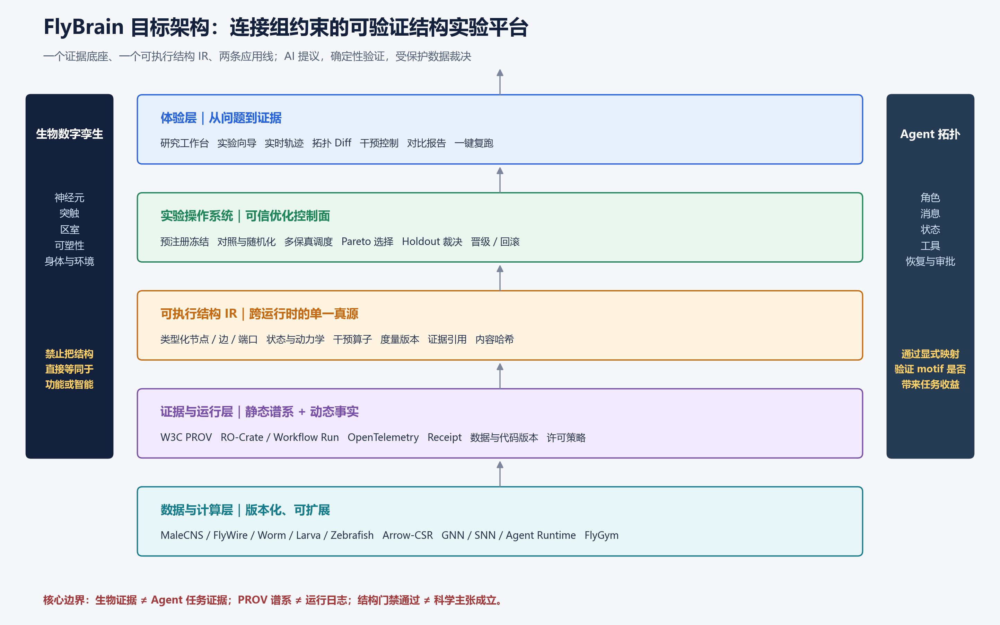

# FlyBrain Connectome 项目全面提升报告

**评估日期**：2026-10-26  
**评估对象**：`flybrain-connectome` 当前工作区与公开发布面  
**评估视角**：连接组/计算神经科学、AI 系统与科研工程、目标用户、前沿技术与竞品  
**报告重点**：不止判断“现在怎么样”，更回答“下一步做什么、为什么、做到什么程度才算完成”

---

## 执行摘要

### 核心判断

这个项目最稀缺的资产，不是 116 个功能单元、270 个模块画像、47 个 MCP 工具或 62 项门禁，而是已经初步形成的一套**把结构、实验、负结果、预注册、反证和证据谱系放在同一仓库中的方法**。当前它同时包含连接组查询、跨物种功能单元、合成拓扑、运行时、演化/修复、科研声明管理、MCP/HTTP、CLI、可视化与多框架导出，广度显著高于一般个人科研项目；但“功能存在”尚未稳定转化为“外部用户可安装、可运行、可比较、可复现、可相信的产品”。当前最准确的定位不是已经完成的“数字生命”，也不是通用 Agent 框架，而是一个**具有领先方法学雏形、尚未完成产品闭环和外部验证的可验证结构实验平台**。

建议将北极星定位升级为：**连接组约束的可验证结构实验平台（Connectome-grounded Verifiable Structure Lab）**。它以真实连接组为证据底座，以可执行结构 IR 为中间表示，以预注册、严格对照、受保护 holdout、动态运行轨迹和可复跑研究包为实验操作系统，同时服务两条明确分隔的应用线：生物数字孪生与 Agent 拓扑。两者共享图结构、干预、度量和证据方法，但不再把“神经元—突触”直接等同于“Agent—消息”，也不再把小尺度 ESN 负结果外推为连接组结构在所有计算任务上无效。

### 最重要的十项结论

| # | 结论 | 对项目方向的含义 |
|---|---|---|
| 1 | **科研纪律是最强差异资产，任务性能不是当前强项** | 把“可信实验控制面”置于品牌中心，性能主张按证据等级展示 |
| 2 | **当前公开面与实际运行面不一致** | 官网仍写 58/58、36 工具；实测 47 MCP 工具、快速门禁 60/62 通过 |
| 3 | **HTTP 与 MCP 并非同一能力面** | MCP 注册 47 工具，但 HTTP `DISPATCH` 仅 12 个；必须做双传输契约测试 |
| 4 | **默认安装并未兑现完整 PROV 体验** | 实测 `prov_json=None`，而快速上手文案容易让用户理解为默认具备完整 PROV |
| 5 | **框架导出是结构转换，不是可运行集成** | LangGraph/CrewAI/AutoGen 导出需升级为真实节点、状态、路由、恢复与编译/运行测试 |
| 6 | **既有科学负结果必须保留，但必须限定外推范围** | FlyGM 等研究已显示连接组结构先验可在其他任务/模型/对照下产生价值 |
| 7 | **具身闭环是科学升维的关键，不是可视化装饰** | 通过 FlyGym/MuJoCo 将“结构—动力学—感知—行为—干预”连成因果实验链 |
| 8 | **通用优化器和监控后台都不宜重造** | 接入 AFlow/EvoAgentX、OpenTelemetry/Langfuse/Phoenix，项目提供可信约束与裁决 |
| 9 | **发布工程是当前最高杠杆** | 独立 wheel、Windows CI、真实 pytest、文档自动生成比继续加门禁更优先 |
| 10 | **未来护城河是跨项目可复用证据，不是仓库内部数量** | 外部复现实验、结构—功能数据集、翻译映射、负结果与边界图册才是长期资产 |

### 建议的战略收敛

**一个平台**：可验证结构实验平台。  
**一个中间表示**：版本化、可执行、带证据引用的 Structure/Experiment IR。  
**两条应用线**：生物数字孪生、Agent 拓扑；显式映射，禁止概念偷换。  
**三类用户**：连接组/计算神经科学研究者、Agent 系统研究者、可复现方法与审计用户。  
**四个核心动作**：提出结构、运行实验、施加干预、生成可复跑证据。  
**五个不做**：不重造通用 Agent 框架、不重造监控平台、不急于训练“连接组基础模型”、不做无对照全脑演示、不在红门禁下继续扩大公开发布承诺。



---

## 1. 评估范围、方法与证据边界

### 1.1 实际核验范围

本次不是只读历史评估文档，而是检查了项目根目录、核心配置、CLI、MCP/HTTP 服务、生成器、运行时、演化模块、导出器、科研声明、门禁、CI、许可、RO-Crate 与公开网页；并实际执行了 `flybrain info`、拓扑生成、结构画像、审计、三种框架导出和 `scripts/run_gates.py --quick`。当前 tracked Python 代码约 **98,806 行**，主生成器约 **5,704 行**，模块注册表约 **3,559 行**，MCP server 约 **1,527 行**，CLI 约 **1,241 行**。这些数字说明项目已具有复杂系统的维护属性，后续需要以架构边界和发布纪律管理复杂度，而不能继续以单文件膨胀方式累加能力。

实测生成流程成功产出 16 节点、14 边的示例拓扑及 JSON/HTML/SwarmLabs 配置；画像明确列出 dynamics、energy、task performance、biological validity 未测量，这是值得保留的诚实设计。三种导出文件均能生成，但检查其内容后确认，它们主要描述节点、角色和连接，不包含目标框架完整运行所需的可调用实现、真实状态语义与恢复机制。快速门禁执行 62 个条目，**60 个通过、Gate 61 与 Gate 64 失败**；失败均涉及 Windows 中文环境下的子进程输出解码异常，Gate 61 还出现 `claim_graph.json not parseable; skipping cross-check` 的警告，这应当被提升为失败而非跳过。

### 1.2 未覆盖与不可据此声称的内容

本次未重新下载并校验全部原始连接组，未进行湿实验或电生理验证，未运行真实付费 LLM 基准，未对目标框架进行全量依赖安装后的执行验证，未做多用户可用性实验、压力测试、渗透测试或真实神经形态硬件能耗测量。因此，本报告对“科学潜力”和“产品方向”的判断不等同于外部独立复现；评分属于基于证据的专家启发式判断，不是性能基准或用户统计。报告中的前沿信息优先采用官方项目、论文和标准资料，竞品能力按公开资料而非本地逐源码复验。

这一边界本身也提示项目应改进证据呈现：所有数字都应带有 `measured / derived / declared / external / simulated / estimated` 等证据类型，所有结论都应携带适用数据版本、模型基底、任务、尺度和时间。只有让“我知道什么、如何知道、在哪些条件下知道”成为产品界面的第一等对象，项目的方法学优势才会被外部用户真正感知。

---

## 2. 项目现状全景：资产很多，但尚未形成单一可信产品

### 2.1 资产盘点

| 资产层 | 当前已有 | 专家判断 | 下一步不应做什么 |
|---|---|---|---|
| 数据与证据 | MaleCNS、线虫、果蝇幼虫、斑马鱼；H01/MICrONS 适配器；manifest 与 anchor | 数据谱系基础较强，跨物种是潜在壁垒 | 不只追求更多数据源，先统一版本、许可、语义与抽样规则 |
| 结构库 | 116 功能单元、270 模块画像、蓝图与 motif、类型化端口 | 宽度足够，检索、组合与证据分级比数量更重要 | 暂停“以数量证明进展” |
| 结构计算 | 生成、画像、签名、比较、修复、发育、群体与演化原型 | 已有平台雏形，但模块边界和任务验证不足 | 不继续把所有逻辑塞入生成器 |
| 科研方法 | 预注册、拒绝规则、负结果、holdout、claim graph、receipt、mutation gate | 当前最具识别度的核心资产 | 不把“门禁绿”误写成“科学主张真” |
| 接入面 | 47 MCP 工具、16 个 CLI 子命令、HTTP、notebook | 入口多，但契约不一致、用户路径分散 | 不继续增加入口，先形成一个黄金路径 |
| 可视化 | 离线 SVG 力导向图、拖拽、tooltip、指标面板 | 适合预览，不是研究工作台 | 不在现有模板上堆按钮，先重构实验流程 |
| 框架连接 | SwarmLabs 配置及 LangGraph/CrewAI/AutoGen 文件导出 | 是 adapter POC，不是生产集成 | 不宣称“导出即可运行” |
| 发布与合规 | MIT 元数据、Tier 文档、AIBOM、RO-Crate、论文包、Pages | 基础齐全，但版本、许可与公开承诺存在漂移 | 不在未清理前扩大传播 |

### 2.2 多视角成熟度评分

以下评分采用 10 分制，**评价的是当前可交付成熟度，不是团队潜力，也不是科学真理程度**。“前沿潜力”单独评分，避免用未来想象抵消当下缺口。

| 维度 | 当前评分 | 主要加分项 | 主要扣分项 |
|---|---:|---|---|
| 项目完整性 | 7.4 | 数据、生成、运行、验证、导出、文档均有资产 | 包、测试、公开网页、HTTP/MCP、版本与许可未闭环 |
| 科技价值 | 7.0 | 真实连接组、跨物种、负结果、预注册与反证纪律 | 结构—功能证据仍弱，外部复现不足，部分主张外推过大 |
| 互动性与流程性 | 4.6 | 有交互预览、CLI、notebook、MCP | 缺少“问题—实验—干预—比较—复跑”的连续工作流 |
| 实用性 | 5.1 | 可用于结构探索、方法研究与派生配置 | 无可安装 PyPI 包、无可运行框架闭环、无标杆行业任务 |
| 使用性 | 5.3 | 低依赖、离线能力、CLI 入口较丰富 | README 过长、文档漂移、路径与版本复杂、Windows 失败 |
| 工程质量 | 5.6 | CI、门禁、哈希、秘密扫描、降级意识较好 | 标准 pytest 入口空、Windows CI 缺失、单文件过大、发布物陈旧 |
| 前沿发展定位 | 8.3 | 结构、数字孪生、自演化、可验证科研交汇处 | 尚未把潜力转化为公开基准、外部用户与独立证据 |
| 外部采纳与验证 | 2.0 | 已公开、有 Pages 与投稿材料 | 本次 GitHub API 核验仍为 0 star/fork/issue/watcher；无外部复现证据 |

### 2.3 当前最关键的矛盾

项目内部“验证对象”很多，外部“被验证的产品”却很少。门禁主要验证仓库内声明和结构不变量，这是必要但不充分的；它不能替代跨操作系统安装、真实 HTTP 契约、目标框架运行、真实任务收益、用户完成率和外部独立复现。下一阶段应把质量定义从“仓库内部多少检查为绿”升级为“多少公开承诺在干净环境和外部工作流中被反复兑现”。

项目还存在叙事层分裂：早期愿景强调“虚拟生物/数字生命”，中期强调“可审计 Agent 拓扑”，论文又突出“preregistration discipline gate framework”。三者可以统一，但不能轮流充当唯一身份。建议采用平台—应用两层叙事：平台始终是“可验证结构实验平台”；数字孪生、Agent 拓扑和科研纪律工具是其应用与能力，不再频繁更换项目本体。

---

## 3. 必须立即处理的真实问题清单

### 3.1 P0 技术与发布问题

| 问题 | 实测/代码证据 | 风险 | 可落地修复 | 验收标准 |
|---|---|---|---|---|
| Windows 门禁崩溃 | Gate 61/64 子进程 GBK 解码异常，随后 `None` 参与字符串操作 | 公开项目在主开发平台不能全绿 | 所有 `subprocess.run` 统一 `text=True, encoding='utf-8', errors='replace'`；辅助函数集中管理 | Windows 10/11 中文 locale 下 62/62；注入测试仍全部能捕获 |
| 解析失败被跳过 | Gate 61 对不可解析 claim graph 仅 WARN | 与 fail-closed 原则冲突 | JSON 解析、schema、交叉核对失败全部 FAIL | 删除/破坏 claim graph 时门禁必红 |
| HTTP 能力面不一致 | MCP `TOOLS` 47 个；HTTP `DISPATCH` 12 个 | 用户看到工具却无法调用 | 用单一 registry 生成 MCP、HTTP、CLI schema；按能力标注 transport | 每个声明支持 HTTP 的工具都有真实 200/4xx 契约测试 |
| 标准测试入口空 | `testpaths=['tests']`，根 tests 不存在；pytest 未装时无法运行 | `make test` 与覆盖率先决条件失真 | 建 `tests/unit/integration/e2e`；纳入 `tools/selfverify/tests`；dev extra 一键安装 | 干净环境 `pip install -e .[dev] && pytest` 成功；覆盖率按核心包统计 |
| 包不是独立产品 | 非 editable 安装仍依赖 checkout/`FLYBRAIN_HOME`；当前 dist 为 3.0.1，代码为 3.00.3 | PyPI 即使发布也难以形成良好体验 | 重构为标准 `flybrain_connectome/` 包；资源用 `importlib.resources`；包含 export 与 motif snapshot | 空目录、无仓库、无环境变量时 generate/audit/export 均成功 |
| 发布面漂移 | Pages 显示 58/58、36 工具；README 示例也有旧值 | 信任损失 | 从运行时生成 `project_status.json`，README/Pages/paper 引用生成片段 | 文档一致性门禁覆盖公开网页源与论文摘要 |
| PyPI 入口不存在 | `flybrain-connectome` JSON API 本次返回 404 | 快速开始第一步失败 | TestPyPI→干净容器→PyPI Trusted Publishing | 三大 OS 的 `pip install flybrain-connectome` 与 demo 通过 |
| 许可证叙事冲突 | GitHub/MIT 与额外限制、私有状态旧文案并存 | 采用与合规风险 | 明确每个文件/数据/派生物许可证；删除过时 private 文案；必要时法律复核 | 单页许可矩阵无矛盾，SBOM/AIBOM 含数据许可与商用限制 |

### 3.2 科学表达与证据问题

项目最需要守住的是“负结果也保留”的科学诚信，同时避免另一种偏差：把局部负结果写成普遍否定。现有 ESN、细胞密化和小规模图实验可以否定特定模型与任务中的优势，但不能否定连接组结构对一切计算、控制或学习无效。2026 年 FlyGM 使用连接组约束的图控制策略，并与保度重连、随机图和 MLP 对照，报告了运动任务中的样本效率与误差优势；这说明项目应将结论改写为带条件的边界声明，并把自己的预注册门禁用于复现和扩展这类更强实验。[FlyGM](https://arxiv.org/html/2602.17997v3)

同理，“25/27 故障隔离”是合成拓扑族内的结果，不应被理解为跨图族或真实连接组已成立。项目自己的 PR1 为 WEAK、PR3 跨族泛化为 FAIL、真实族未通过，这些边界应在 README 和可视化中与阳性数字同等醒目。建议所有 claim 卡片固定显示：**主张、证据层级、适用范围、反证、未测维度、最后复算时间、对应 receipt**。这会比单纯增加新论文更能建立长期学术信用。

MaleCNS 的正式引用也应统一。当前论文、代码注释和不同文档出现不同作者/年份表述，公开 MaleCNS 项目页显示 v1.0 于 2026-06-08 发布、论文于 2026-09-03 发表，Cell 论文题名为 *Sexual dimorphism in the complete Drosophila male central nervous system connectome*。建议建立一个机器可读 `datasets.yaml`，将数据集版本、官方引用、下载地址、许可证、快照哈希、计数口径和已知局限作为单一真源，所有论文与页面自动生成。[MaleCNS 官方项目](http://male-cns.janelia.org/) [Cell 论文](https://www.cell.com/cell/fulltext/S0092-8674(26)00942-6)

### 3.3 交互与安全问题

当前 HTML 每帧执行节点两两排斥计算，复杂度为 O(N²)，并且 `requestAnimationFrame` 永久运行，即使布局已稳定仍持续消耗资源；它适合几十节点预览，不适合大规模连接组或长时间研究。节点/边 tooltip 使用 `innerHTML` 拼接产物字段，如果未来允许加载外部 JSON，会形成不必要的注入面。建议近期先做文本转义、稳定后停帧、缩放/搜索/筛选与键盘可达性，中期对千节点以上切换 Canvas/WebGL 与 Web Worker，不要把全脑数据直接塞入当前 SVG 模板。

默认体验中的 PROV 也需要诚实分级。本次生成的审计结果为 `prov_json=None`，并提示缺少可选 `dataprov`；因此 quickstart 应明确“核心结构 provenance 默认可用，标准 PROV-JSON 需 `[prov]` extra”，并在 UI 显示 `structural / standard-prov / runtime-traced / independently-replayed` 四个等级，而不是一个模糊的“已溯源”徽章。默认安装是否应包含 `dataprov` 可以产品化决定，但无论选择哪一种，都不能让宣传超过实际产物。

---

## 4. 目标定位：从“项目集合”升维为“可验证结构实验平台”

### 4.1 为什么是这个定位

连接组领域已经有优秀的数据浏览、细胞类型查询和形态工具；MaleCNS 官方提供 Cell Type Explorer、Dimorphism Explorer、neuPrint 和 Clio，项目没有必要在“查看神经元”上重复竞争。数字果蝇方向也已出现浏览器内全中枢模拟、刺激、虚拟身体、游戏和语言接口；其中 Neural Canvas 等产品的免安装和具身体验领先当前项目，但不少公开实验仍缺乏乱序结构、参数匹配、关闭可塑性等对照。[MaleCNS 官方项目](http://male-cns.janelia.org/) [数字果蝇项目目录](https://shaduf.ai/p/digital-fly-catalog/projects/)

Agent 方向同样拥挤：LangGraph 已有持久执行、流式、中断和人工参与，EvoAgentX 已集成生成、执行、评估和多种优化器，Langfuse/Phoenix 已提供轨迹与评估平台。项目真正能够占据的空位是它们之间的“可信结构实验层”：生物结构如何被转成可执行候选，候选如何在固定预算与对照下运行，何时允许晋级，失败如何保留，结果如何跨运行时复算。[LangGraph 官方文档](https://docs.langchain.com/oss/python/langgraph/overview) [EvoAgentX 论文](https://aclanthology.org/2025.emnlp-demos.47/)

### 4.2 两条应用线必须分隔，再通过映射连接

**生物数字孪生线**的节点是神经元、细胞群、区室或功能单元，边是突触/有效连接，状态由神经元模型、突触参数、可塑性与环境共同决定，验证对象是神经活动、扰动反应和行为。**Agent 拓扑线**的节点是模型、工具、确定性函数或子图，边是消息、控制流和状态转移，验证对象是任务质量、成本、延迟、恢复、安全和人工监督。两条线可以使用同一个图 IR，但必须通过显式 `TranslationContract` 说明 motif 如何映射为路由/状态/消息策略，哪些生物属性被保留、哪些被舍弃、哪些只是灵感命名。

这一分隔会直接提升科学质量与产品可信度。当前“synthetic organism”同时承载生物与 Agent 语义，容易使用户把生物 provenance 误解为 Agent 任务有效性证明。未来每个产物应同时带有 `biological_evidence` 与 `task_evidence` 两个独立区块：前者可以很强而后者为空，反之亦然；只有实际运行相应实验后，才能建立跨层结论。

### 4.3 平台的最小闭环

平台不需要先做“大而全数字生命”，只需要把下面这条链做到不可替代：

```text
研究问题
  → 选择结构族与证据版本
  → 生成候选 + 自动匹配对照
  → 冻结预注册与计算预算
  → 多保真运行（结构 / 动力学 / Agent / 具身）
  → 干预与反事实
  → 受保护 holdout 裁决
  → 拓扑 Diff + 轨迹 + 证据报告
  → 一键复跑 / 分享 / 晋级或回滚
```

现有资产已经覆盖这条链的大部分零件，下一步主要是**把它们从并列功能变成同一实验对象上的连续状态转换**。每次操作都应更新同一个 `experiment_id`，而不是分别生成无关联的 JSON、HTML、日志和论文图。

---

## 5. 科技价值提升：从结构相关走向可校准、可干预、可外验

### 5.1 建立结构—动力学—功能三层模型

当前拓扑画像明确未测 dynamics 与 task performance，这是正确边界；下一阶段不是简单增加更多结构指标，而是让每个结构候选可绑定多种动力学后端和任务协议。建议 IR 至少包含：`structure`、`node_dynamics`、`edge_dynamics`、`state_schema`、`input_encoder`、`output_decoder`、`plasticity`、`interventions`、`metrics`、`evidence_refs`。同一个结构可在 ESN、率模型、LIF、GNN 或 Agent runtime 上运行，结果必须标注后端，禁止跨后端混写。

计算神经科学前沿已经表明，“固定连接 + 学习单神经元/突触参数 + 任务约束”可以产生对神经活动的可检验预测； fly visual system 的连接组约束模型已与多项实验测量对照。项目应优先选择一个可控回路，将未知参数从手工常数变成带先验和不确定性的可学习对象，并评价未观测神经元或新刺激的泛化，而不是只评价训练读出。[Lappalainen 等，Nature 2024](https://www.nature.com/articles/s41586-024-07939-3) [连接组约束 RNN 研究](https://pubmed.ncbi.nlm.nih.gov/41145885/)

### 5.2 设计一个能代表项目的旗舰科学实验

建议选择“**连接组结构是否提高扰动后的感觉—运动恢复能力**”作为第一条旗舰主线，而不是再次泛化地测试“生物拓扑是否更聪明”。它同时利用项目现有的故障隔离、修复、结构画像、预注册和负结果纪律，又能接入具身闭环。最小任务可选视觉 looming→escape 或简单趋避，不直接从完整行走/飞行开始；对照包括原始连接组子图、保度重连、保模块重连、随机稀疏图、参数匹配 MLP/GNN、无结构先验控制器，以及必要的无动力学/脚本基线。

实验必须把“结构贡献”和“参数/提示词贡献”分开。可设置四个实验臂：固定参数只换结构、固定结构只优化参数、结构参数联合优化、随机搜索同预算对照。主要终点应预注册为行为恢复或样本效率，次要终点包括神经活动相似度、连接成本、推理延迟与干预敏感性；所有调参只在开发集，最终任务族和随机种子只开启一次。即使结果为负，也能形成高价值边界论文与公开 benchmark。

### 5.3 用多保真与主动实验代替单一昂贵模拟

未来实验调度可采用四级保真：L0 结构指标和静态反证，L1 小规模 ESN/率模型，L2 GNN/LIF 与标准任务，L3 FlyGym/MuJoCo 具身验证。AI 调度器根据不确定性、预计信息增益和成本选择下一实验，而不是让 LLM 自由生成大量低价值候选。每个候选先过结构门禁和 cheap proxy，只有能改变当前结论边界的实验才升级到更高保真。

验收主动调度是否有效，应比较相同计算预算下的“结论不确定度下降、发现边界数量、holdout 正确率”与随机/网格调度；如果没有优势，就保留普通调度。这样项目能把现有 `progress.json` 从展示分数变成真正决定下一步行动的反馈信号，也能把“AI for Science”落实为可测量的实验效率，而不是加入一个聊天窗口。

### 5.4 能耗与神经形态结论重新分级

NeuroBench 已区分硬件无关算法轨与部署相关系统轨，并定义正确性、复杂度和真实时延/效率的不同测量方法。项目应将当前能耗结果标为模拟代理，不再以“能耗优势已证伪”覆盖所有硬件与任务；新增字段 `energy_evidence=estimated|simulated|measured`，只有系统轨实测才能使用 measured。优先复用 NeuroBench harness 和任务，再决定是否需要专用硬件。[NeuroBench 官方](https://neurobench.ai/) [NeuroBench 论文信息](https://research.tudelft.nl/en/publications/the-neurobench-framework-for-benchmarking-neuromorphic-computing-/)

---

## 6. AI 项目能力提升：可信自演化，而不是再造一个 Agent 框架

### 6.1 用可执行 IR 替代“文件格式导出”

建议先定义与框架无关的 `AgentGraphIR`，包含 typed state、reducers、node executable refs、conditional routers、parallel/join、retry/timeout、checkpoint、human approval、tool permissions、trace exporter 和 evaluation hooks。LangGraph、Microsoft Agent Framework、CrewAI Flows 等只是后端；AutoGen 标为 legacy 适配器，避免将长期新功能押在维护导向 API 上。每个适配器使用明确版本矩阵，生成 Python 包或项目，而非只生成 YAML/JSON 描述。

最低验收不是“文件生成成功”，而是：在 mock LLM 下真实执行；注入节点异常后按策略恢复；中断后从 checkpoint 继续；人工审批可以暂停/恢复；OTel trace 可导入至少一种开源后端；拓扑 hash 与每次节点执行关联。只有全部通过，README 才能写“supports runnable LangGraph export”。

### 6.2 把优化器变成插件，把晋级权留在项目

EvoAgentX/AFlow、DSPy/GEPA、随机搜索、贝叶斯优化和 GA 都应实现统一的 `SearchStrategy` 接口：输入候选空间、预算和只读开发集反馈，输出带谱系的候选；它们不能直接接触 holdout，也不能自行宣布成功。项目负责预注册、预算记账、结构约束、对照生成、反证、Pareto 前沿和晋级/回滚。这样可以利用外部优化生态的快速进展，同时强化项目最独特的可信控制面。[EvoAgentX](https://arxiv.org/html/2507.03616v1)

优化目标应从单一 health 或 score 改为显式多目标：任务质量、恢复能力、token/时延/能耗、拓扑复杂度、证据覆盖、风险与人工干预次数。结构健康只能作为约束或代理指标，不能长期替代任务适应度；当前 `self_evolving_loop.py` 的“无 fitness function”可以保留为结构探索模式，但产品界面必须清楚区分“结构更健康”与“任务更好”。

### 6.3 LLM 的正确位置：提议、解释、翻译，不做最终裁判

LLM 最适合承担四类工作：根据研究问题生成候选实验 IR；把自然语言限制编译为类型化端口与路由；从失败轨迹提出可证伪机制；把结果转写成带证据链接的报告。它不应单独决定 claim 是否 SUPPORTED，不应修改已冻结阈值，不应直接访问受保护测试集，也不应在没有确定性 schema 校验的情况下执行高风险演化。

可建立“神经—符号科研回路”：LLM 提议 → JSON Schema/类型系统验收 → 确定性模拟与统计检验 → 反证 Agent 寻找反例 → 受保护证据裁决 → 人工批准晋级。每次 LLM 调用记录模型、提示词版本、输入哈希、输出哈希、token 与成本；关键科学报告中的每一句定量结论必须链接到结构化结果，而不是模型记忆。

### 6.4 自演化的生产安全边界

未来允许系统修改自身拓扑时，必须具备候选沙箱、资源配额、工具最小权限、数据隔离、签名谱系、canary、自动回滚和人工批准。任何自修改只产生“候选版本”，不能直接覆盖当前稳定版本；晋级依赖冻结 benchmark 与在线小流量证据，回滚对象包括结构、提示词、工具配置、数据视图和运行时版本。这个项目可以把已有的结构签名、receipt 和门禁优势延伸到 Agent 发布治理，但必须先完成真实运行与 OTel 轨迹，否则只能审计静态设计，不能审计实际行为。

---

## 7. 互动性与流程性提升：从拓扑预览到实验工作台

### 7.1 用户真正需要完成的工作流

| 用户 | 进入项目时的问题 | 当前阻力 | 目标黄金路径 |
|---|---|---|---|
| 连接组研究者 | 这个结构来自哪里，在什么条件下影响活动/行为？ | 数据、脚本、实验和图分散 | 选数据集→选回路→运行/干预→看活动与证据→导出研究包 |
| Agent 研究者 | 这个拓扑能否改善任务、恢复与成本？ | 导出后仍需大量手写，缺对照与轨迹 | 选任务→生成可运行图→同模型对照→看 trace/cost→复跑 |
| 方法/审计用户 | 结论能否被独立重算，失败是否被隐藏？ | receipt 对非专家不友好 | 打开 claim→看预注册/反证/holdout→一键 replay→看差异 |
| 新访客 | 这个项目究竟能做什么？ | README 长、概念多、安装链不完整 | 免安装 demo→一个交互实验→下载结果→本地复现 |

### 7.2 工作台的七个核心视图

1. **Question**：选择研究问题与证据等级，不先让用户面对 116 个单元。  
2. **Design**：图编辑、模块检索、证据过滤、端口兼容提示和 TranslationContract。  
3. **Protocol**：对照、种子、预算、主要终点、拒绝规则；冻结前检查，冻结后版本化修改。  
4. **Run**：排队、进度、实时状态、日志、成本、取消/恢复；支持 mock 与真实后端。  
5. **Intervene**：节点/边沉默、保度重连、参数扰动、环境变化；显示干预前后差异。  
6. **Compare**：拓扑 Diff、Pareto 曲线、效应量与置信区间、失败样本，不只显示赢家。  
7. **Evidence**：谱系树、运行 trace、数据版本、代码 hash、claim 边界、下载 RO-Crate 与复跑命令。

现有 SVG 预览可保留为 Design 的轻量组件，但不应继续承担完整产品。近期优先实现 Run、Compare、Evidence 三视图，因为它们最能把项目与“好看的脑图”区分开。移动端可只读分享，复杂编辑以桌面为主；所有交互结果都写回同一 experiment manifest，刷新页面后可恢复。

### 7.3 免安装演示的正确内容

在线 demo 不应只播放力导向动画，而应提供一个 3 分钟可完成的反事实实验：用户选择“原始 motif / 保度重连 / 随机图”，点击运行预计算或轻量实时任务，再施加模块沉默，观察性能与恢复差异，最后展开证据卡。大模型或全脑计算可以用可复现的预计算轨迹降级，但页面必须标注 `replayed recorded run` 还是 `live execution`，不能把录像伪装成实时模拟。

竞品已经在浏览器全脑模拟、身体控制与游戏交互上形成强体验，项目的差异化 demo 应让用户第一次直观看到“同样节点和边数，为什么一个结论能成立、另一个不能”，并能把整个实验下载复跑。这样互动性本身就成为科研诚信的表达方式。

---

## 8. 实用性与使用性提升：一条可安装、可运行、可复现的黄金路径

### 8.1 发布架构重构

建议把当前仓库整理为 monorepo，但发布为标准 Python 包：`flybrain_connectome/core`、`schemas`、`datasets`、`generators`、`runtimes`、`experiment`、`adapters`、`provenance`、`cli`。`synthetic_bio_topology.py` 拆为模型定义、蓝图、生成、provenance、渲染和 CLI；`module_registry.py` 将数据资源与逻辑分离。无需急着引入微服务，先建立可测试的模块边界与稳定公共 API。

`pyproject.toml` 应以 wheel 独立运行为验收，而不是以 editable checkout 为默认假设。motif snapshot、schema 和示例放入 package data；原始大数据继续外置并通过内容寻址缓存。`flybrain_export.py` 等公开命令所需模块必须进入 wheel。考虑到 PyPI 已有 `flybrain` 项目且提供同名命令，应评估新增 `flybrain-connectome` 或 `fbc` 命令，保留兼容别名，降低冲突。[现有 flybrain PyPI](https://pypi.org/project/flybrain/)

### 8.2 数据与内存路径

`core.py` 注释强调 memory-mapped-friendly，但实际 `np.load` 未使用 `mmap_mode='r'`，并同时加载六份 int32 数组。按代码所述 151,856,684 行估算，六份数组约 **3.64 GB**；构建时三份 int64 原始列约 3.64 GB，单个 int64 排序索引约 1.21 GB，六数组+原始列+两个索引的理论体量已约 **9.72 GB**，还未计其他临时对象与注释。该估算不是实测峰值，却足以说明需要系统做内存基准和流式构建。

建议以 CSR/CSC 或 Arrow/Parquet 分区存储为主，按需只加载一个方向的索引；构建阶段分块排序/外部排序，运行时优先 `mmap_mode='r'`，缓存携带数据版本、dtype、行数、哈希与构建器版本。公开性能指标包括首次构建时间、峰值 RSS、冷/热查询 P50/P95、磁盘占用和并发查询稳定性。对普通用户则提供小型采样包，避免“5 分钟 quickstart”背后隐藏数十 GB 数据准备。

### 8.3 文档信息架构

README 应从约 70 KB 的“项目全史”压缩为 10 分钟内可读的产品入口：它是什么、三条边界、安装、一个 demo、一个真实导出、证据状态、文档链接。CHANGELOG 保留历史，但不承担教学；数十份评估报告进入 `docs/research/audits/`，最新状态由单一 `STATUS.md` 生成。文档分为 User Guide、Research、Adapters、API、Evidence/Claims、Contributing、Releases 七组。

所有数量、命令、输出路径、工具清单和门禁状态都应来自构建时生成的 status 文件。论文提交前运行同一发布门禁，避免 README、paper、Pages 和 CITATION 各自维护作者、版本、工具数和引用。外部用户最需要的不是更多文档，而是每个页面都描述同一个当前版本。

---

## 9. 竞品优势对照与项目应占据的位置

| 竞品/生态 | 其核心优势 | 项目当前差距 | 不应复制 | 应形成的互补优势 |
|---|---|---|---|---|
| MaleCNS Cell Type Explorer / neuPrint / Clio | 官方数据、细胞类型、连接查询与注释体验 | 官方语义与浏览成熟度不足 | 再造通用连接组浏览器 | 派生 motif 的可复算版本、跨数据集映射与实验证据 |
| FlyBrainLab / flyvis / connectome 模型 | 可执行回路、神经动力学、活动预测 | 当前以结构与模块代表层为主 | 声称静态 motif 就是神经计算 | 可学习参数、活动预测、扰动与生理外验 |
| NeuroMechFly / FlyGym / flybody | MuJoCo 身体、环境、Gymnasium 接口 | 缺标准具身闭环 | 自造身体物理引擎 | 将可验证结构实验接入标准身体与任务 |
| FlyGM | GNN 控制、保度/随机/MLP 对照、具身运动 | 既有负结果基底较窄 | 否定所有结构先验 | 复现/扩展严格对照，形成预注册结构 benchmark |
| Neural Canvas、浏览器 flybrain | 免安装、刺激、全中枢运行、强体验 | 当前仅小规模静态预览 | 用视频或动画证明“数字生命” | 实时对照、证据叠加、实验分享与一键复跑 |
| LangGraph / Agent Framework / CrewAI | 成熟运行时、状态、恢复、生态 | 当前导出不可直接运行 | 新建通用编排框架 | 生物约束 IR、对照执行、证据与晋级策略 |
| EvoAgentX / AFlow / DSPy | 自动工作流与提示优化 | 当前优化器与真实任务闭环弱 | 再做一个通用优化算法集合 | 插件式搜索 + holdout + 反证 + 受控晋级 |
| Langfuse / Phoenix / LangSmith | 轨迹、评估、成本与生产观测 | 当前主要是静态谱系 | 自建通用 trace 平台 | PROV + OTel 联合，关联结构版本与运行事实 |
| RO-Crate / Workflow Run 生态 | FAIR 研究对象与跨工具复跑 | 当前 crate 偏静态声明 | 把文件打包等同于可复现 | 可执行研究包、容器/环境、参数与 receipts |
| NeuroBench | 算法/系统双轨标准评测 | 能耗证据主要是模拟 | 将估计能耗写成实测 | 证据分级、标准任务与真实部署测量 |

竞争策略可概括为：**数据浏览借官方、身体物理借 FlyGym、图控制借 GNN/flyvis、Agent 运行借主流框架、优化借 EvoAgentX/AFlow、观测借 OTel 生态，FlyBrain 专注结构约束、实验协议、反事实、证据与晋级。** 这不是减少项目价值，而是把有限资源集中到别人最难替代的部分。

---

## 10. 前沿技术路线：未来 3—5 年的合理位置

### 10.1 从“连接组数据”到“可计算结构知识库”

近期不应训练大规模“连接组基础模型”，而应先构建高质量结构知识库：跨数据集统一 cell type、脑区、连接、神经递质置信度、区室与发育信息；每条派生 motif 附抽样规则、版本和不确定性；每个结构有规范 ID 与内容哈希。随后可做自监督图表示学习，用于 motif 检索、相似结构推荐、异常检测和实验先验，而不是让嵌入模型直接生成功能结论。

当积累足够多的结构—扰动—功能结果后，再训练“结构结果 surrogate”才有意义。训练数据不仅包括成功结果，也包括当前项目最丰富的负结果和边界；模型输出应是带置信区间的预期结果与建议下一实验，并持续用新实验校准。这个路线比直接宣称基础模型更可行，也更能形成他人难以复制的数据飞轮。

### 10.2 从静态数字生物到校准型数字孪生

数字孪生的关键不是规模，而是持续校准与反事实预测。项目可沿“回路孪生→感知运动闭环→多模块发育/修复→全系统多保真”推进，每一步都要求模型对未见刺激、损伤或发育阶段做预测，并用新数据更新不确定性。树突区室、神经调质、可塑性和身体环境按研究问题逐步加入，避免一次性追求全生物细节。

具身层应优先采用 FlyGym/NeuroMechFly 的标准接口。NeuroMechFly v2 已提供 MuJoCo、Gymnasium、视觉/嗅觉与身体状态接口，适合把项目结构后端作为可替换 controller；项目的贡献是实验协议与证据，而不是另造身体。[NeuroMechFly/FlyGym](https://nely-epfl.github.io/flygym-gymnasium/)

### 10.3 从固定工作流到安全自演化系统

未来 Agent 与数字生物都将持续修改结构，真正稀缺的是“怎样证明一次修改值得保留”。项目可成为这类系统的验证与治理层：候选在沙箱中产生，经过结构约束、开发集、反事实、安全测试和 holdout，形成 Pareto 前沿；稳定版通过 canary 和回滚机制发布；任何性能提升都能追溯到具体结构、数据、提示词、模型和运行环境。

这个定位与自演化 AI、Agentic Science、数字孪生和可信 AI 的长期趋势一致，但实现顺序必须是“先可运行、再可测量、再可优化、最后自主”。跳过前两步直接做自我进化，只会放大不可解释和不可复现。

---

## 11. 分阶段实施路线图

### 11.1 P0：0—2 周，发布真相与可靠性收口

| 工作包 | 具体动作 | 负责人角色 | 完成定义 |
|---|---|---|---|
| Windows 与 fail-closed | 修 Gate 61/64；集中 subprocess helper；claim graph 解析失败即红 | Python/QA | Windows、Ubuntu、macOS 全绿；变异注入仍有效 |
| 测试重建 | 建真实 pytest 树；核心单元、HTTP/MCP 契约、CLI、导出 smoke；Windows CI | QA/研发 | 干净环境一条命令测试；核心覆盖率有基线并逐周提高 |
| 包与发布 | 标准包结构、独立 wheel、TestPyPI、PyPI Trusted Publishing | 发布工程 | 无 checkout 的干净容器完成 generate/audit/export/demo |
| 契约统一 | 工具单一 registry；HTTP 覆盖声明工具；协议错误格式一致 | 后端 | MCP/HTTP/CLI 工具文档自动生成；双传输契约测试通过 |
| 公开真相 | 修 Pages/README/paper/Quickstart；发布状态自动生成 | 文档/发布 | 无 58/58、36 工具等旧值；无虚假默认证据承诺 |
| 许可与仓库 | 清理 private 旧文案、许可矩阵、陈旧 dist、根实验产物 | 维护者 | 发布分支干净；许可无冲突；产物与版本一致 |

**阶段出口**：不是“又增加了多少功能”，而是外部用户在三种 OS 上能从 PyPI 安装并完成一个带明确证据等级的 demo，所有公开数字一致，所有发布检查为绿。

### 11.2 P1：第 3—6 周，打通一个真实黄金路径

选择 LangGraph 作为首个真实后端，完成 mock LLM 下可执行、checkpoint 恢复和 OTel trace；同时上线轻量工作台，只支持一个实验模板“原始 motif vs 保度重连的模块扰动恢复”。UI 串起 Question、Protocol、Run、Compare、Evidence，产物可用同一 experiment ID 在 CLI 复跑。CrewAI/Agent Framework 在 IR 稳定后再接，避免三个半成品并行。

阶段验收建议邀请 5 名目标用户，不给予口头指导，观察是否能完成安装、运行、对照和导出。目标可设为至少 4/5 在 15 分钟内完成、所有用户能正确说出“结构溯源不等于任务有效”、发现的问题全部进入版本化 backlog。这个小规模可用性测试比继续内部自评更能改变产品。

### 11.3 P2：第 7—12 周，完成旗舰科学实验

预注册“结构对扰动恢复的影响”，建立六类对照、参数/结构分离实验臂、多随机种子、开发/验证/受保护测试隔离、效应量与置信区间；先在率模型或 GNN 上闭环，再接一个 FlyGym 感觉—运动任务。所有主要输出自动生成图、表和 claim 卡，负结果按同一流程发布。

阶段出口不是必须阳性，而是**结果能够回答一个清晰问题，且其他人能够用同一研究包复算**。如果结构没有贡献，项目获得边界与方法学论文；如果有贡献，则获得第一条真正有外部竞争力的结构—功能证据。

### 11.4 P3：第 3—6 月，形成可信优化与多保真平台

接入至少一种外部优化器和一种 surrogate/贝叶斯策略；建立 L0—L3 多保真调度、Pareto 前沿、预算记账、holdout 权限和回滚。发布 Workflow Run RO-Crate，OTel 与 PROV 通过 experiment/run IDs 关联；扩展一个结构—功能数据源，如 MICrONS 或 ZAPBench 类任务，但前提是能支持独立外验，而非只增加适配器数量。

### 11.5 P4：第 6—12 月，建立外部证据网络与数字孪生升维

推动至少两个外部团队/用户独立复现旗舰实验，建立公开 leaderboard，但默认展示置信区间、成本和证据等级，避免只排最高分。逐步加入发育、修复、区室或神经调质中的一个问题驱动维度；在具备真实校准数据后，才将“数字生物”升级为“校准型数字孪生”。自演化功能只在沙箱和受控发布协议下开放。

---

## 12. 优先级 backlog：价值、成本与验收

| 优先级 | 项目 | 价值 | 成本 | 依赖 | 核心验收 |
|---|---|---|---|---|---|
| P0-1 | Windows 编码与 Gate 61 fail-closed | 极高 | 低 | 无 | 当前两红消除，变异测试不减弱 |
| P0-2 | 独立 wheel + PyPI | 极高 | 中 | 包重构 | 空目录无仓库可运行 |
| P0-3 | MCP/HTTP 单一契约 | 极高 | 中 | registry | 所有公开工具真实可调用 |
| P0-4 | 公开状态自动生成 | 高 | 低 | status schema | Pages/README/paper 同版 |
| P0-5 | 真实 pytest + Windows CI | 极高 | 中 | 测试分层 | 干净环境测试可执行 |
| P1-1 | AgentGraphIR + LangGraph runnable | 极高 | 中高 | P0 | 执行、恢复、trace 全通过 |
| P1-2 | 单实验工作台 | 极高 | 中高 | 实验 manifest | 用户完成完整对照与导出 |
| P1-3 | OTel + PROV run 关联 | 高 | 中 | run ID | 可从节点执行追溯到结构证据 |
| P2-1 | 旗舰结构—恢复实验 | 极高 | 高 | P1 | 严格对照、一次 holdout、可复跑 |
| P2-2 | FlyGym 最小闭环 | 高 | 高 | 动力学后端 | 感知→结构→行为→干预闭环 |
| P2-3 | 数据/内存基准与 CSR 改造 | 高 | 中 | 数据版本 | 峰值 RSS 与 P95 明显改善且结果一致 |
| P3-1 | 优化器插件与同预算竞赛 | 高 | 中 | P2 | 优化器不可触 holdout，结果可比较 |
| P3-2 | 主动多保真调度 | 高 | 高 | 足够实验数据 | 同预算信息增益优于随机/网格 |
| P3-3 | 图表示与 surrogate | 中高 | 高 | 结构化结果集 | 校准、外推和不确定性达标 |
| P4-1 | 外部复现网络 | 极高 | 持续 | 研究包稳定 | 至少两个独立复现 |
| P4-2 | 安全自演化与 canary | 中高 | 高 | 真实运行时 | 候选不直改稳定版，可自动回滚 |

---

## 12.1 建议的命令与对象模型

未来的用户体验可以被压缩为一组围绕实验对象的命令，而不是围绕文件类型不断增加子命令：

```bash
flybrain experiment init "Does the motif improve recovery after lesion?" \
  --template lesion-recovery --dataset malecns:v1.0
flybrain experiment design EXP_ID --motif inhibitory_hub --controls degree,rewire,module,random
flybrain experiment freeze EXP_ID --seeds 20 --budget 2h --primary recovery_auc
flybrain experiment run EXP_ID --backend gnn --fidelity L2
flybrain experiment intervene EXP_ID --lesion module:memory
flybrain experiment compare EXP_ID --against controls --pareto quality,cost,recovery
flybrain experiment evidence EXP_ID --format ro-crate --output ./repro-pack
flybrain experiment replay ./repro-pack --clean-env
```

`Experiment` 是最小持久化对象，`Structure`、`Protocol`、`Run`、`Intervention`、`MetricResult`、`Claim`、`Receipt` 都通过稳定 ID 关联。CLI、MCP、HTTP、工作台和 notebook 只操作同一服务层，避免五种入口各自实现业务逻辑。

---

## 13. 新的度量体系：从 vanity metrics 到真实进展

### 13.1 北极星指标

建议将北极星指标设为：**每周被独立复跑并完成裁决的实验数**。它同时要求实验可运行、证据完整、结果可理解和外部可用，比 star、工具数或门禁数更接近项目长期价值。项目早期没有外部用户时，可先在干净容器和不同 OS 上由自动复跑代替，但必须明确标为 internal replay，不伪装成 independent replication。

### 13.2 四层 KPI

| 层级 | 指标 | 建议目标方向 |
|---|---|---|
| 用户价值 | 首次成功实验时间、无指导完成率、导出后真实运行率、复跑成功率 | <15 分钟；持续提升；不以页面访问量替代 |
| 科学价值 | 有对照的实验比例、外部复现数、边界/负结果公开率、holdout 违规数 | 对照接近全覆盖；外部复现增长；holdout 违规为零 |
| 工程质量 | 三 OS 发布成功率、契约覆盖、P95 查询、峰值 RSS、回归缺陷 | 发布稳定；性能按版本追踪 |
| 前沿能力 | 同预算信息增益、多保真成本节约、跨任务/跨族泛化、参数校准误差 | 与随机/固定调度及公开基线比较 |

工具数、功能单元数、蓝图数、门禁数、文档数只能作为资产库存，不再作为版本标题的主要成就。门禁增加必须对应一个曾发生或高概率的失效模式；如果两个门禁验证相同风险，应合并而不是追求编号增长。

---

## 14. 风险与防止路线偏离的机制

| 风险 | 早期信号 | 预防机制 |
|---|---|---|
| 平台过大、主线失焦 | 同时推进全脑、Agent、基础模型、商业化 | 每阶段只有一个旗舰实验与一个发布出口 |
| AI 生成超过验证能力 | 候选和文档增长快于真实 run | LLM 只能提议；预算、schema、确定性验证和 holdout 强制 |
| 生物—Agent 概念偷换 | 用生物 provenance 宣传任务性能 | 双证据区 + TranslationContract + 文案门禁 |
| 负结果被过度普遍化 | “连接组无计算价值”式绝对表述 | claim 必须绑定基底、任务、尺度和适用域 |
| 门禁复杂但产品脆弱 | 内部全绿、外部安装/运行失败 | 干净环境、真实后端、用户任务纳入发布门禁 |
| 数据/许可漂移 | 同数据不同计数和引用 | datasets.yaml 单源、hash、许可矩阵、发布复核 |
| 优化过拟合 | 反复访问测试集、阈值随结果变化 | 受保护 holdout、一次性开启、所有访问记账 |
| 自演化安全风险 | 候选直接覆盖稳定版、权限过大 | 沙箱、最小权限、canary、签名、回滚、人工批准 |
| 合规过度宣传 | “PROV 即 EU AI Act 合规” | 改为合规矩阵；PROV 只支持谱系证据，运行/风险/监督分别记录 |

---

## 15. 最终建议：项目应如何进入更高层次

项目已经越过了“能否做出许多组件”的阶段，下一步必须完成三次转变。第一，从**仓库内部自证**转向**外部干净环境与真实工作流验证**，先修复发布、契约和测试。第二，从**结构生成与静态谱系**转向**结构—动力学—功能—干预的可执行证据**，用一个旗舰实验建立真正的科学高度。第三，从**所有能力自己实现**转向**开放生态中的可信控制面**，复用标准运行时、优化器、观测与具身平台，把研发资源集中在证据、对照、反事实和晋级机制上。

如果只能选一条未来主线，建议选择：**“可复跑的连接组结构反事实实验平台”**。它既能保留当前科研纪律的差异化，又能自然扩展到 Agent 拓扑和数字生命；既允许接入最新 GNN、世界模型、自演化 Agent 和主动学习，又不会被任何单一模型或框架淘汰。项目最终应让竞争者即使拥有更大的模型、更炫的仿真或更多的 Agent 工具，仍愿意使用 FlyBrain 来回答一个问题：**这个结构为什么值得被相信，在什么条件下成立，失败后如何复现与回滚。**

### 立即执行顺序

1. **本周**：修 Gate 61/64 与 fail-closed，建立 Windows CI；冻结新增功能。  
2. **两周内**：独立 wheel、TestPyPI/PyPI、统一 47 工具契约、公开状态自动同步。  
3. **六周内**：LangGraph 真实可运行后端 + 一个对照实验工作台 + OTel/PROV 关联。  
4. **十二周内**：完成首个预注册、严格对照、可复跑的结构—恢复旗舰实验。  
5. **一年内**：形成外部复现网络和多保真可信优化平台，再决定更大规模数字孪生与自演化投入。

这条路线不会要求项目放弃“虚拟生物”的长期愿景，而是为它补上当前最缺的三块地基：**真实运行、严格证据、外部复现**。有了这三块地基，前沿叙事才会从项目文档中的可能性，变成科研与工程生态中可被使用、检验和持续积累的能力。
