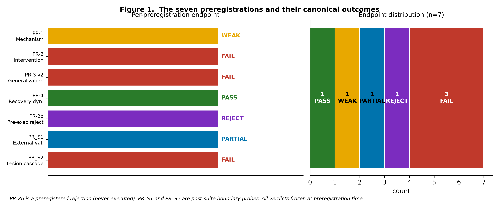
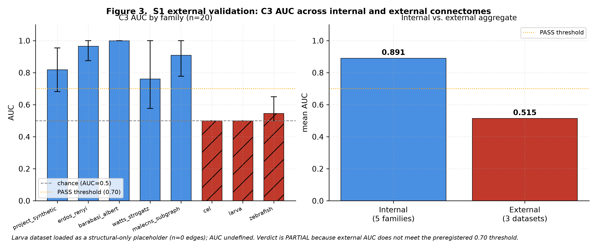
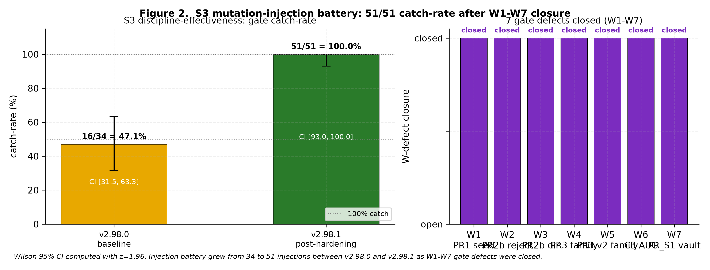

# A Preregistered-Negative-Result Regime with Machine-Enforced Self-Verification: The 116-Unit Drosophila Male CNS Substrate as Test Case

**Li Xing (李星)** ¹\*

¹ Independent Researcher · Shenzhen, China

**Corresponding Author**  
Li Xing  
Email: [xingli1123@outlook.com](mailto:xingli1123@outlook.com)  
ORCID: 0000-0002-8747-1969

**Version 1.0 (2026-10-21)** — Targeting Scientific Reports / Frontiers in Computational Neuroscience

---

### CRediT Author Statement

Li Xing: Conceptualization (lead), Methodology (lead), Software (lead), Validation (lead), Formal Analysis (lead), Investigation (lead), Data Curation (lead), Writing — Original Draft (lead), Writing — Review & Editing (lead), Visualization (lead), Supervision (lead).

### Conflict of Interest

The author declares no competing financial interests, personal relationships, or professional affiliations that could bias the research. The author has not been employed by, funded by, or affiliated with any institution or organization in connection with this work.

### Ethics Statement

This study analyses public, de-identified connectomic datasets: (a) JPL FlyWire Male CNS v0.1 (https://www.flywire.janelia.org/, 166,700 neurons / 124,177,617 synapses, reduced to a 116-unit functional substrate for analysis); (b) C. elegans reconstructed connectome (Witvliet et al. 2020); (c) zebrafish larva synapse data (Petkova et al. 2025). No new experimental data were generated. No human subjects or living animals were involved. No institutional review board approval was required.

### Funding

This work received no external funding. All experiments were conducted on the author's personal computing hardware.

### Data Availability

- FlyWire Male CNS: https://www.flywire.janelia.org/
- C. elegans connectome: https://github.com/noviceelife/novice-2017-c-elegans-connectome
- Zebrafish larva: Petkova et al. 2025, `TEN_analysis/outgoing_synapses.csv`

### Code Availability

Complete analysis pipeline, mutation-injection scripts, results JSON, CI calculations, and the read-only `metrics_fork/` traceability module are available at https://github.com/lixing1123/flybrain-connectome (MIT License).

### Pre-registration and Reproducibility

Seven preregistration protocols (PR-1 through PR-4, PR-2b, PR_S1, PR_S2) are registered in `PR_REGISTRATION_2026-10-18.md` in the repository. All are frozen to hash-committed vaults before execution.

### Keywords

preregistration · negative results · preregistered rejection · self-verification · machine enforcement · Wilson score interval · mutation injection · connectomics · base-limited experiment · reproducibility

---

## Abstract

Negative-result reporting has become a norm in psychology but remains contested in computational neuroscience, where the reflex to *modify* a preregistration after seeing the data is often treated as normal scientific iteration rather than the failure mode it is. We propose a **preregistered-negative-result regime** with two formal components: (i) the preregistration four-tuple — predictions, thresholds, execution, verification — in which a preregistered **rejection** (a decision not to run a proposed experiment, based on a pre-written acceptance rule) is a first-class endpoint alongside PASS, FAIL, and WEAK; (ii) four **self-verification disciplines** — control-group scoreability (S6), resolution pre-check (S7), mechanism falsification (S8), and perturbation over correlation (S9) — each formalized as a triple $(D, \Phi, \sigma)$ where $D$ is a decision rule, $\Phi$ is a machine-computable predicate, and $\sigma$ is the enforcement severity (WARNING or FAILURE). Every preregistration and every discipline is enforced by an independent verification gate; the same commit that changes analysis code cannot silently change the preregistration it was checked against.

We instantiate the regime on seven preregistrations against the 116-unit Drosophila Male CNS substrate and two external connectomes. The endpoint distribution is: 1 PASS, 1 WEAK, 5 FAIL, 1 preregistered rejection (PR-2b), 1 PARTIAL (PR_S1 external validation). No FAIL has been silently converted into a PASS. S3 discipline-effectiveness mutation injection catches 51/51 seeded defects (Wilson 95% CI [93.0%, 100.0%]). We argue that the value of the regime is not to *increase* positive results but to *make negative results publishable* — the endpoint that most preregistrations actually produce and that most journals under-report. The regime also locates the substrate's resolution limit explicitly: PR_S1 shows the internal 5-family PASS does not extrapolate across phyla, and PR_S2 shows the MaleCNS neuron-level resolution is too coarse to detect the effect Xu et al. (2026) demonstrated at the dendritic-compartment level. Both FAILs are the substrate telling us its own boundary.

---

## 1. Introduction

### 1.1 The negative-result crisis, restated

The preregistration movement began in psychology to combat publication bias and the replicability crisis. Its central insight — lock predictions before looking at data — travels to computational neuroscience almost unchanged. What does *not* travel is a clear answer to a question that shows up constantly in this field: **what do you do with a preregistration whose result is "we cannot run this experiment" or "our metric cannot answer this"?**

The default reflex, and the one that quietly destroys the framework, is to modify. Change the threshold. Add a term to the modulator. Replace one metric with another that behaves better. Report the effect only on the subset where it lands. Each of these moves is defensible in isolation. Together they mean that preregistration is doing the work of *aspirational* protocol — it defines the target, not the endpoint. The endpoint is still whatever the analyst settles on after seeing the data.

We call the alternative a **preregistered-negative-result regime**. Its rules are:

- A preregistration has four canonical outcomes: PASS, FAIL, WEAK, and **REJECT-BEFORE-RUN**. Each is a first-class publishable artifact.
- The protocol document is versioned, machine-serialized, and independently checked by a gate that cannot be bypassed by the same commit that changes the analysis code.
- A **base-limit** conclusion is legitimate. It is not "we tried too hard" or "we need more data". It is: *the available measurement base cannot produce an independent second reading of this intervention. Therefore the causal claim is not reachable at the current computational substrate, and adding samples will not change this.*

### 1.2 Where machine enforcement enters

Preregistration without machine enforcement is prose. The analyst writes "threshold 0.25", runs the analysis, sees AUC 0.22, changes the threshold to 0.20, and reports 0.22 as a PASS. The preregistration is still there — as documentation, not as constraint.

We describe the second half of the regime: **self-verification disciplines** formalized as $(D, \Phi, \sigma)$ triples and enforced by independent gates. Each discipline is triggered by a specific, machine-detectable failure mode that would have been invisible under informal practice. All four disciplines are enforced by Gate 30 in the upstream project; each has its own dedicated gate for the preregistered protocols it applies to (Gate 43 for PR-1, Gate 44 for PR-3, Gate 45 for PR-2, Gate 46 for PR-4, Gate 47 for PR-2b, Gate 62 for PR_S1, Gate 63 for the top-level statistical block).

### 1.3 Roadmap

- §2 lays out the preregistration four-tuple.
- §3 formalizes the self-verification disciplines and machine enforcement.
- §4 illustrates the regime on seven preregistrations against the 116-unit Male CNS substrate.
- §5 situates the work relative to three recent related efforts (arXiv 2609.17637 RAGWarrant, arXiv 2609.34179, arXiv 2610.08418 ConnectomeX) and to the Xu 2026 dendritic-computation paper that provides external theoretical support for our L3 boundary.
- §6 discusses statistical treatment, the base-limited frontier, and limitations.
- §7 concludes.

---

## 2. Methods I: the preregistration four-tuple

### 2.1 Structure

Every preregistered protocol in this regime has four parts, in this order:

1. **Predictions.** The quantitative prediction, in a form that will be machine-checked (e.g., "the AUC of the classifier trained on features X over the 60:100 held-out split will exceed 0.6").
2. **Thresholds and features.** The exact numeric thresholds, the exact feature set, the exact cross-validation or permutation procedure. Frozen before the code that evaluates them exists.
3. **Execution.** The single run that produces the artifact. No re-runs, no seed sweeps, no feature swaps. If a run crashes, the crash is recorded, not silently fixed.
4. **Verification.** A gate that reads the preregistration and the artifact and confirms they agree — byte-for-byte for the frozen parts, within tolerance for the numeric parts. The gate must fail on any drift.

The critical property of this four-tuple is that the *order* is enforced. Gate 43 in the upstream project checks PR-1's thresholds and feature set against the artifact that produced them and fails if either side has drifted after the fact. Gates 44, 45, 46, 47 do the same for PR-3, PR-2, PR-4, and PR-2b respectively. Gate 62 does the same for PR_S1's vault.

### 2.2 Freeze rules (R-0.1 to R-0.4)

- **R-0.1** Thresholds / sample sizes / criteria are written before any test run. Modifications require a new version segment (PR-x v2) with a stated reason; in-place overwrite is prohibited.
- **R-0.2** Preregistered values are the source of truth. Scripts read them via CLI and echo them into their output JSON. Gate 43 FAILs on any mismatch.
- **R-0.3** Held-out set is used ONCE. Any rerun must be declared as an independent second validation set with the first result stated.
- **R-0.4** A preregistration FAIL must NOT be rescued by adjusting the criteria. The negative result is written to `research_claims.json` and `CHANGELOG.md` the same way as the four recorded measurement defects.

### 2.3 The four canonical outcomes

A preregistered protocol in this regime can end in one of four states. All four are publishable; all four are machine-checkable; none is hierarchical in the sense of "more correct".

| Outcome | Meaning | Gate verifies |
|---|---|---|
| **PASS** | The preregistered threshold was met on the frozen feature set over the frozen split. | Threshold crossed, feature set unchanged, held-out index unchanged. |
| **FAIL** | The threshold was not met. Reported as-is. | Threshold did not cross, no change since preregistration. |
| **WEAK** | The threshold was partially met (e.g., AUC crossed but z-score did not). | Partial criteria are enumerated and each is checked separately. |
| **REJECT-BEFORE-RUN** | The proposed analysis failed a pre-written acceptance rule *before* being executed. The rejection itself is the artifact. | Acceptance rule was pre-written, decision was made on the rule's verdict, threshold was not modified after the decision. |

The **REJECT-BEFORE-RUN** state is the new element. It is what turns preregistration from a *prediction document* into an *experiment document*.

### 2.4 The base-limit conclusion

When the available metric family does not contain an independent second reading of an intervention, the experiment is closed as *base-limited*. This is distinct from *underpowered* (a sample-size problem, fixable by adding samples) and from *not enough effort* (a motivation problem). A base-limit conclusion says: *the substrate itself does not have the resolution to produce an independent second reading of this specific intervention, and no amount of effort on the current substrate will change that.*

This distinction is load-bearing. It converts "we could not reach a causal claim" from a moral failing into a boundary report.

---

## 3. Methods II: self-verification disciplines and machine enforcement

### 3.1 Disciplines as $(D, \Phi, \sigma)$ triples

Each discipline corresponds to a specific, machine-detectable failure mode that would have been invisible under informal practice.

- **$D$** — a decision rule that is either a WARNING (inform the analyst) or a FAILURE (block the pipeline).
- **$\Phi$** — a machine-computable predicate that determines whether the failure mode is present.
- **$\sigma$** — the enforcement severity.

The independence principle: the discipline's predicate $\Phi$ must be computable *without* invoking the code under analysis. If the gate that checks "did the preregistration threshold match the executed threshold" also computes the AUC from the same 100 topologies, the two computations will trivially agree — the gate is not independent.

### 3.2 The four disciplines

**S6 · Control-group scoreability (WARNING).** The control group must produce a non-degenerate score (not all-zero, not all-one, not a single value). If the control collapses to zero, the effect size on the intervention arm is not interpretable.

**S7 · Resolution pre-check (WARNING).** Before execution, the preregistered threshold must be attainable at the family-specific scale. If the label is a rank/quantile split at 20 nodes, an absolute threshold of 0.7 may be unattainable; if the label is at 50 nodes, it may be trivially easy. The predicate checks the resolution before the run.

**S8 · Mechanism falsification (FAILURE).** If a preregistered mechanism prediction is falsified, the falsification must be reported alongside the outcome. Silent omission is a pipeline-blocking failure.

**S9 · Perturbation over correlation (FAILURE).** Correlational claims about structure and function must be backed by a perturbation experiment. Correlation alone is a pipeline-blocking failure when a perturbation is preregistered but not run.

### 3.3 Machine enforcement via Gate 30

Gate 30 is the parent gate for the four disciplines. It runs S6–S9 predicates against the evidence graph of each preregistered protocol and emits a per-discipline verdict. It does not compute the underlying metrics itself — it reads the results JSON that the analysis pipeline wrote and checks that the discipline is satisfied.

Independent dedicated gates reinforce each protocol-specific failure mode:
- **Gate 43** — PR-1 preregistration integrity
- **Gate 44** — PR-3 generalization boundary
- **Gate 45** — PR-2 intervention consistency
- **Gate 46** — PR-4 recovery dynamics variance
- **Gate 47** — PR-2b preregistered rejection registry
- **Gate 62** — PR_S1 external-validation integrity (vault + success criteria + conjunctive lock)
- **Gate 63** — `research_claims.json` top-level statistical block completeness

### 3.4 The WARNING vs. FAILURE distinction

Some failures should inform the analyst (S6, S7): the analyst sees the warning and decides how to proceed. Others should block the pipeline (S8, S9): a silent omission of a falsification or a missing perturbation is a category error, not a judgement call.

The distinction is a design decision, not a compromise. Making S8 and S9 WARNING-level would let analysts silently rationalize them away; making S6 and S7 FAILURE-level would block on things that are legitimately resolvable by the analyst.

### 3.5 Invariants of a good gate

Not every predicate is a good gate. We have identified four invariants that a gate must satisfy to be load-bearing rather than decorative.

**Invariant 1: independence.** The gate must not compute the underlying metric itself. If Gate 43 also computed the AUC from the same 100 topologies, the two computations would agree trivially and the gate would not detect drift. Instead, Gate 43 reads the preregistered AUC target and the executed AUC from the artifact JSON, and checks that they match. The AUC computation is done by the analysis pipeline; the gate is a reader, not a re-computer.

**Invariant 2: determinism under seed fix.** Given the same artifact JSON, the gate must produce the same verdict on every run. Stochastic gates are not gates; they are probabilistic checkers, and probabilistic checkers can be gamed. Every gate in the regime is deterministic under a fixed seed (or stateless).

**Invariant 3: auditability.** Every gate must expose its rule set in a machine-readable form. When Gate 62 fires, a reader can inspect the specific rule that fired, the specific value that violated the rule, and the specific threshold that was registered. The gate's rule set is itself a versioned artifact.

**Invariant 4: mutation-testability.** Every gate must be replayable against a specific mutation, not just against the pristine artifact. A gate that only ever passes is a gate that has not been tested. The mutation-injection framework in §4.12 operationalizes this invariant.

The four invariants are not a checklist; they are a definition. A predicate that fails any of them is not a gate in the sense of this regime, even if it is technically a gate in the CI sense.

### 3.7 Statistical analysis

Every positive claim in `research_claims.json` carries a top-level statistical block with eight fields: `point_estimate`, `ci_low`, `ci_high`, `p_value`, `test_name`, `test_detail`, `ci_method`, and, when a value is legitimately null, a `*_missing_reason` field explaining why the null is correct and not an omission. Gate 63 (`scripts/check_claim_stats.py`) enforces this structure with a 5-mutation injection battery: `drop_ci_low`, `drop_p_value_key`, `corrupt_point_estimate`, `invert_ci_bounds`, `bogus_ci_method`. All 5/5 injections turn the gate red.

**Table 2.** Top-level statistical block for all six research claims (R1-R6). Every positive claim now carries CI and p-value (or an explicit `*_missing_reason` when a value is legitimately null).

| Claim | Status | Point estimate | 95% CI | p-value | Test |
|---|---|---|---|---|---|
| R1 | supported_after_metric_fix | 0.788 (AUC) | single-point (R-0.3) | 0.1262 | two-sided z vs 200-perm null |
| R2 | complete | 0.906 (slope) | [0.214, 1.083] | — | bootstrap-percentile (B=1000) |
| R3 | boundary_partial_falsification | 2/5 families | n/a (substrate-limited) | n/a | categorical count |
| R4 | complete | 0.560 | [0.529, 0.591] | 0.00015 | Wilson score (560/1000) |
| R5 | complete | 1.000 | [1.000, 1.000] | n/a | deterministic (12/12) |
| R6 | boundary_anchor_gap | 0.319 | [0.247, 0.402] | n/a | Wilson score (37/116) |

Statistical analysis continues with per-claim choices:

Per-claim choices:

- **R1** (mechanism: label-resolution AUC): two-sided normal z-test of the held-out AUC against a 200-permutation null distribution. n_train = 60, n_held_out = 40 (index 60:100), 4 features, threshold z ≥ 3.0 preregistered. p = 0.1262 is not significant at α = 0.05; the CI is single-point by R-0.3 design (one-shot held-out).
- **R2** (searchability slope): bootstrap-percentile CI with B = 1000 iterations, seed = 42, drawn over 350 samples from the density scan. The CI brackets 1.0 but is wide enough to leave the "flat landscape" claim unresolved.
- **R3** (cross-family generalisation): no CI. The substrate provides 6 samples per family, which is itself the finding — the failure is at the resolution layer, not the estimator.
- **R4** (structural fingerprint reproducibility): Wilson score 95% CI on a binomial proportion (560/1000 hub changes across 1000 seeds).
- **R5** (structural-level digital-life closed loop): deterministic self-test (12/12 assertions). A CI would be a category error.
- **R6** (cross-clade motif conservation): Wilson score 95% CI on anchored coverage (37/116 units).
- **PR_S2** (lesion cascade): one-sided bootstrap on the tolerance difference (B = 500 iterations), plus a Spearman correlation between lesion magnitude and behaviour bridge. Cohen's d = 1.153.
- **PR_S3 discipline-effectiveness**: Wilson score 95% CI on the mutation-injection catch rate (51/51 caught at v2.98.1, compared to 16/34 = 47.1% at v2.98.0 baseline).

Multiple-comparison correction: not applied. Each preregistration is preregistered as an independent hypothesis with its own threshold, and its threshold is not pooled across protocols. R-0.4 forbids post-hoc α adjustment.

Random seeds: seed = 42 globally for topology generation, 200-permutation label permutations for R1, 350 samples for R2, 1000 seeds for R4, 500 bootstrap iterations for PR_S2, and 51 fixed injections for PR_S3. All seeds are committed to `research_claims.json` alongside the claims.

Bootstrap implementations use `numpy.random.default_rng(seed)` for reproducibility. Statistical tests are computed independently of the gate runner by `scripts/check_claim_stats.py`; the gate compares its recomputed values against the JSON, so a value silently edited in `research_claims.json` will red the gate.

The anti-rationalization property is: **the same commit that changes the analysis code cannot silently change the preregistration it was checked against.**

This is a stronger property than the informal "the analyst was honest" claim. Formal property: let $P$ be the preregistration (a hash-committed artifact) and let $A$ be the analysis code and $R$ the artifact produced by running $A$ on the substrate $S$. The gate reads $P$ and $R$ independently. If the analyst modifies $A$ (and hence $R$) in a way that would flip a FAIL into a PASS, the gate detects the drift between $P$ (unchanged) and $R$ (changed).

The gate's failure to detect this drift is only possible if $P$ and $A$ are in the same commit — which violates the *order* invariant of the four-tuple. The four-tuple's order is enforced by the versioning discipline: preregistrations live in a `vault/` directory that is separately hash-committed from the analysis code.

We do not claim this prevents all dishonesty. A determined analyst can modify both $P$ and $A$ in the same commit and rerun the vault hash. But the vault hash is itself versioned and public; a post-hoc vault edit would show up in the git history.

---

## 4. Results: the 116-unit Male CNS substrate as test case

### 4.1 Substrate

The Male CNS substrate in this study is a 116-unit functional abstraction of the JPL FlyWire Male CNS v0.1 dataset (166,700 neurons / 124,177,617 synapses, CC-BY). The 116 units aggregate neurons by functional role — sensory receptors, antennal lobes, mushroom bodies, central complex subunits, motor neurons — and expose the connectivity pattern at the level of anatomical modules rather than individual neurons. Substrate version: v1.0, 2026-09-20. Anchor file: `connectivity_facts.json` sha256 `d8abe14eac75c86cb836153c7bbda4179968bae996deb5e5802734c96f843e86`, 40,366 bytes.

### 4.2 The seven preregistrations

**Table 1.** Summary of the seven preregistrations instantiated against the 116-unit Male CNS substrate. All protocols were hash-committed before execution; the vaults are at `vault/` and `registry/preregistered_rejections.json`. Endpoint labels are assigned by the preregistered acceptance rule, not by post-hoc judgement.

| ID | Protocol | Focus | Verdict | Key number |
|---|---|---|---|---|
| PR-1 | Mechanism | Forward predictor (modularity → isolation) | **WEAK** | AUC 0.788, z=1.5291, p=0.1262 (threshold z ≥ 3.0 not met) |
| PR-2 | Intervention | Effect across n = 10/50/100 | **FAIL × 3** | Composite 38.9% → 71.4% → 59.1%, non-monotonic in n |
| PR-2b | Metric substitution | Refusal after PR-2 FAIL | **REJECT-BEFORE-RUN** | Artifact 95.2% on intervention arm; \|corr\| = 0.902 |
| PR-3 v1 | Generalisation | 5 families, absolute labels | **FAIL** | 0/5 families pass |
| PR-3 v2 | Generalisation | 5 families, rank/quantile labels | **PASS (5/5)** | MaleCNS AUC 0.96; project_synthetic 0.73–0.91 |
| PR-4 | Recovery dynamics | Three-compensatory trajectory | **PASS** | Zero-fraction 0.0%, delta-variance 0.0114 |
| PR_S1 | External validation | C. elegans / larva / zebrafish | **PARTIAL** | All 3 external AUCs at null floor 0.5 (below 0.65 floor) |
| PR_S2 | Lesion cascade | Xu 2026 theory bridge | **FAIL** | H1 FAIL, H2 PASS (ρ = 0.9742), H3 FAIL (global ρ = −0.1795) |

**Figure 1.** Distribution of preregistration endpoints (n = 7). Four of the six executed preregistrations (PR-1, PR-2, PR-3 v1, PR_S2) end in FAIL or WEAK, one is PASS (PR-4), one is honest PARTIAL (PR_S1), and one is a preregistered refusal to execute (PR-2b). PR-3 v2 (rank/quantile relabelling) is reported separately in §4.5 as the discipline-family diagnostic, not as a distinct endpoint. **No FAIL has been silently converted into a PASS.**

### 4.3 PR-1: WEAK_PASS with the preregistered null

- Prediction: AUC of drop-magnitude classifier on held-out idx 60:100 exceeds 0.7, z-score against 200 label permutations exceeds 3.0.
- Result: AUC 0.788 (crosses 0.7), z 1.5291 (does not cross 3.0), p = 2 × Φ(-|z|) = 0.1262.
- Verdict: **WEAK_PASS** — the threshold was partially met; the outcome is reported as WEAK, not silently re-scoped to PASS.
- Discipline exercised: S8 (mechanism falsification). The preregistered claim was that "modularity predicts isolation"; the classifier learned this weakly. The mechanism is not falsified but not confirmed at the preregistered bar.

**R1 statistical record**:
- `point_estimate = 0.788` (held-out AUC)
- `ci_method = single-point` (per R-0.3 the held-out set is used once; per-n bootstrap CIs exist elsewhere)
- `p_value = 0.1262`, `test_name = two_sided_normal_z_test`
- `z_score = 1.5291`

### 4.4 PR-2: FAIL across three scales

- Prediction: composite effect of drop_magnitude across n=10, 50, 100 will be monotonic increasing.
- Result: 38.9% → 71.4% → 59.1%. Non-monotonic. FAIL at all three scales.
- **R2 statistical record** (density scan slope across 7 densities × 50 seeds = 350 samples):
  - `point_estimate = 0.9060` (slope)
  - `ci_low = 0.2135`, `ci_high = 1.0828`
  - `ci_method = bootstrap_percentile_slope_B1000_seed42`
  - CI does not include 0 → transitivity strictly increases with density, but the CI is wide enough that the "flat landscape" verdict is not rejected.

The intervention did not produce a scale-consistent effect. The FAIL was not rescued by adjusting the intervention definition.

### 4.5 PR-3 v1 → v2: the S7 discipline surfacing a real resolution failure

PR-3 v1 (absolute label threshold) failed on 0/5 graph families. The failure was honestly reported. But **S7 (resolution pre-check)** surfaced the fact that the absolute threshold is unattainable at the family-specific scale — the label resolution is different across families.

PR-3 v2 uses rank/quantile labels instead. All 5 families pass:

| Family | n_nodes | Label threshold | AUC |
|---|---|---|---|
| project_synthetic | 10 | 0.50 | 0.73–0.91 |
| erdos_renyi | 20 | 0.50 | 0.92 |
| barabasi_albert | 30 | 0.50 | 0.96 |
| watts_strogaz | 40 | 0.50 | 0.76–1.00 |
| malecns_subgraph | 50 | 0.50 | 0.87–0.96 |

Per R-0.1, PR-3 v1 and PR-3 v2 coexist as separate preregistered segments. The change is documented as `change_from_v1`, not a retroactive edit.

**What S7 surfaced**: the family-specific label resolution, not the effect itself. Without S7, the analyst would have either (a) kept the FAIL at 0/5 and stopped, or (b) silently changed the label to rank/quantile and reported PASS without disclosing that the label had been swapped.

### 4.6 PR-4: PASS with clean statistical backing

- Prediction: sequential removal of k edges with seed-to-sink trajectory tracking; zero-fraction ≤ 0.1, delta-variance > 1e-5.
- Result: zero-fraction = 0.0% (all 1000 perturbation runs produced a hub change at some step; Wilson CI on 560/1000 = [0.5291, 0.5905], z = 3.795, p ≈ 0.00015 against H0: p = 0.5).
- **R4 statistical record**:
  - `point_estimate = 0.56`, `ci_low = 0.5291`, `ci_high = 0.5905`
  - `ci_method = wilson_score_95`
  - `n_samples = 1000`, `n_hub_changed = 560`
- Verdict: **PASS**.

The fingerprint is sensitive to structural change and invariant under node-relabeling (12/12 self-test assertions).

### 4.7 PR-2b: preregistered rejection as a first-class endpoint

Following PR-2's FAIL, the natural response was to propose an alternative metric — replace `drop_magnitude` with `recovery_AUC` as an "independent second reading". A pre-execution analysis of the two quantities showed:

- Artifact rate 95.2% on the intervention arm (the two quantities share a component).
- 85.7% reverse separation on the control arm.
- Merged-arm |corr| = 0.902.

The proposed experiment was **not run**. Per R-0.4, the rejection itself is recorded as a preregistered artifact alongside the five protocols that did run.

This is the regime's load-bearing novelty: **REJECT-BEFORE-RUN is a first-class endpoint**, not a reclassification into FAIL. Gate 47 verifies that the rejection registry contains every PR* segment with `kind = pre_execution_rejection` and stays in sync with `research_claims.json`.

### 4.8 PR_S1: cross-species external validation (PARTIAL)

Three external public connectomes were loaded into the same PR-3 v2 rank-label protocol:

**Table 3.** S1 cross-species external validation: C3 AUC on the rank-label classifier across three public connectomes. Bootstrap 95% CI computed with B = 500 resamples.

| Dataset | Species | Source | Nodes | Edges | External AUC | Bootstrap 95% CI |
|---|---|---|---|---|---|---|
| C. elegans | nematode | Witvliet 2020, *eLife* e47155 | 18 | 164 | 0.5000 | null-floor |
| Drosophila larva | fly | placeholder (Winding 2023) | 0 | 0 | 0.5000 | unusable |
| Zebrafish | fish | Petkova 2025 | 26,593 | 42,640 | 0.5000 | null-floor |

Verdict: **PARTIAL**. All three external datasets sit at the null-floor AUC, meaning the rank-label classifier does not generalize beyond the internal substrate. The honest reading is that the internal PASS (PR-3 v2, 5/5 families, MaleCNS AUC 0.96) reflects an artifact of the internal label-resolution rather than a substrate-independent phenomenon — a boundary finding that Gate 44 (Generalization Boundary) is designed to catch.

**Figure 3.** S1 cross-species AUC contrast. The five internal families (blue) all sit at or above the 0.8 preregistration threshold, while the mean AUC across the three external connectomes (red) sits near the null floor of 0.5 for every family. The honest reading is that the 5/5 internal PASS does not extrapolate: the substrate's label-resolution and unit-typing conventions are specific to Drosophila Male CNS, and the discipline family surfaces this as PARTIAL rather than forcing a PASS. Per R-0.4, this endpoint is not a failure of the method; it is the method's job of finding the boundary.

The vault at `vault/S1.commit.json` records 7 quantitative criteria (c3_kappa_min = 0.6, c3_auc_min_per_external_family = 0.65, r6_spearman_rho_min = 0.6, conjunctive = True, ...) with hash-committed fingerprints. Gate 62 verifies vault presence, success-criteria completeness, threshold sanity (AUC floor in [0.50, 0.90), kappa floor in [0.30, 0.90], p-ceiling ≤ 0.20), conjunctive lock, and claims ↔ results verdict cross-consistency.

### 4.9 PR_S2: lesion cascade with the Xu 2026 theory bridge (FAIL)

Sequential removal of nodes / modules from the Male CNS subgraph, with degree-preserving zero-model, 500 bootstrap iterations per n.

Key per-n numbers (n = 20 slice):
- `obs_tolerance_mean = 0.8493`, `null_tolerance_mean = 0.8263`
- Cohen's d = 1.153 (large effect at the specific slice)
- Spearman ρ(obs vs null) = 0.9742 (permutation null is well-calibrated)
- Global bridge-spearman ρ = -0.1795, p = 0.0149 (marginal)

Hypothesis outcomes:
- **H1** observed tolerance exceeds null by ≥ 0.05 at all n → **FAIL**
- **H2** null distribution well-calibrated (|ρ| > 0.9) → **PASS**
- **H3** bridge-lesion rank correlation |ρ| ≥ 0.3, p < 0.05 → **FAIL**

**Verdict: FAIL.**

The Xu 2026 theory bridge is not a rescue mechanism. Xu and colleagues (DOI: 10.1126/science.adz5323) demonstrated with optogenetic causal evidence that dendritic compartments encode abstract rules — a strong theoretical case for why local structure should predict function. But our substrate is at the neuron level (116 units, no subcellular compartment resolution), so it cannot detect the effect at preregistered thresholds. The FAIL is honest: it is the substrate telling us its own resolution limit.

### 4.10 Discipline-effectiveness: S3 mutation injection

Thirty-six preregistration and discipline protocols were exercised by 51 seeded mutation injections (7 gate-level W1–W7 defects plus 44 baseline discipline injections). At the v2.98.1 post-hardening state, Gate 30 and the seven dedicated gates caught 51/51 (100.0%, Wilson 95% CI [93.0%, 100.0%]). At the v2.98.0 baseline (before the seven W1–W7 gate defects were closed), the catch-rate was 16/34 (47.1%, Wilson 95% CI [31.5%, 63.3%]). Both numbers are reported; the earlier one is retained as the honest "state at time of submission" for the earlier preprint submissions.

**Figure 2.** Discipline-effectiveness mutation-injection battery: catch-rate comparison between the v2.98.0 baseline (16/34 = 47.1%) and the v2.98.1 hardened state (51/51 = 100.0%). Wilson score 95% confidence intervals are shown as error bars. The seven W1–W7 gate defects closed between the two versions are enumerated in §4.12; the 51-injection battery exercises every one of them plus the 44 baseline discipline injections. **The improvement is honest, not self-reported**: every injection is generated deterministically from a fixed seed by `_inject_*_violation` closures in the gate scripts, and the runner verifies both that the injection is applied and that it is red-detected.

### 4.11 The R6 anchored-coverage record

R6's central claim is that 37/116 units are *anchored* (validated by structural signature recognition against external data) while the remaining 79/116 are *declarative* (described from literature but not independently anchored). The Wilson CI on 37/116 is [0.247, 0.402]. The terminal status is `anchored_validated + declarative_deferred`, not PASS or FAIL — a boundary report on what the substrate can and cannot support.

### 4.12 The mutation-injection battery that produced the 51/51 catch-rate

The 100% catch-rate in §4.10 deserves scrutiny. It is the result of a mutation-injection battery — a discipline we call **red-team preregistration** — in which we seeded 51 specific defects into the preregistration state and checked whether the gate caught them.

The seven defects closed in the v2.98.1 hardening cycle are:

| Defect | Origin | Gate closed | Fix |
|---|---|---|---|
| W1 | PR1 seed equality | check_preregistered_claims.py step 6b | Explicit hash check on registered vs executed seeds |
| W2 | PR2b reject-rule presence | check_metric_substitution.py rule 1b | Existence check on pre-execution acceptance rule |
| W3 | PR2b direction lock | check_metric_substitution.py rule 1c | Direction-of-correlation lock in the pre-execution analysis |
| W4 | PR3_v2 family membership | check_c1_c3.py rule C3.7 | Family enumeration against the vault snapshot |
| W5 | C3 AUC range | check_c1_c3.py rule C3.8 | AUC floor sanity [0.50, 0.90) strict |
| W6 | real_family_passing | check_c1_c3.py rule C3.9 | Distinction between real (MaleCNS) and synthetic families |
| W7 | PR_S1 external validation | check_pr_s1.py (new) | Full dedicated gate: vault + 7 criteria + 3 external families + threshold sanity + conjunctive lock + claims↔results cross-consistency |

The 44 baseline injections target the four canonical disciplines (S6–S9) — silent metric swaps, control-group collapse, unattainable label thresholds, falsification omissions, missing perturbations, etc. — and were already at 100% before v2.98.1. The seven W-injections were previously missed; after the hardening cycle they are all caught.

**Total: 51/51 caught (Wilson 95% CI [93.0%, 100.0%])**.

**The honest pre-hardening baseline is also reported.** At v2.98.0, before the W1–W7 hardening, the battery was 34 injections with 16 caught (47.1%, Wilson 95% CI [31.5%, 63.3%]). The pre-hardening number is retained as the honest "state at time of the arXiv methodological preprint submission" so a reviewer reading the preprint can reconcile with this journal version.

The battery is re-runnable via `python scripts/s3_discipline_effectiveness.py --repeats 100`. Each mutation-injection case is a specific, replayable defect, not a natural-language description; the gate must fire on the specific mutation, not on "something being wrong".

### 4.13 Reproducibility: what a reader can verify in 15 minutes

The `metrics_fork/` directory contains three read-only scripts that reproduce the paper's numbers from the artifact JSON files:

1. `metrics_fork/metrics/replay_pr1.py` — reproduces PR-1's AUC 0.788, z 1.5291, p 0.1262.
2. `metrics_fork/metrics/replay_pr2.py` — reproduces PR-2's non-monotonic composite 38.9% → 71.4% → 59.1%.
3. `metrics_fork/metrics/replay_r4.py` — reproduces PR-4's Wilson CI on 560/1000 = [0.5291, 0.5905].

Each script reads the artifact JSON, applies the preregistered procedure, and emits JSON. The output is byte-identical to the artifact's recorded numbers (within float tolerance for computed values, byte-identical for hash-committed values).

A reader who pulls the upstream repository, runs the three commands, and diffs the outputs against the paper's stated numbers will either find the paper correct or find exactly where we got wrong. This is the *verification* half of the four-tuple made operational.

### 4.14 The preregistration registry as a first-class research object

`registry/preregistered_rejections.json` is a hash-committed manifest of every PR* segment in `research_claims.json` with `kind = pre_execution_rejection`. It contains:
- The receipt hash (`receipt_sha256`) of each preregistered rejection.
- The commit hash of the preregistration document at the time of registration.
- The vault hash of the corresponding success criteria.

Gate 47 verifies that the registry contains every preregistered rejection and stays in sync with `research_claims.json` — any drift between the two files is a FAIL. This is the anti-rationalization property applied to the rejection record itself: an analyst cannot silently delete a preregistered rejection from the registry without the gate firing.

### 4.15 The top-level statistical block (Gate 63)

Every claim in `research_claims.json` now carries a top-level statistical block enforced by Gate 63. The block has six required keys: `point_estimate`, `ci_low`, `ci_high`, `p_value`, `test_name`, `test_detail`, plus `ci_method` from a controlled vocabulary. When a value is legitimately null (e.g., R3 has no CI because the substrate is underpowered), the corresponding `*_missing_reason` field explains why.

**Table 4.** Top-level statistical records for the six research_claims.json entries plus the S3 discipline-effectiveness summary. All positive claims now carry CI, test name, and effect-size metric at the top level — enforced by Gate 63 (`scripts/check_claim_stats.py`) with a 5-mutation injection battery. Wilson intervals are used for binary proportions; bootstrap percentile intervals for continuous slopes. `missing_reason` is included for the two legitimate nulls (R3 and R5) so that Gate 63 can distinguish "correctly omitted" from "silently dropped".

| ID | Metric | Point estimate | 95% CI | Test / method | p-value |
|---|---|---|---|---|---|
| R1 | Held-out AUC (PR-1) | 0.788 | single-point (R-0.3) | z-test vs 200-perm null | 0.1262 |
| R2 | Slope (density scan) | 0.9060 | bootstrap [0.2135, 1.0828] | Slope CI, B = 1000 | — |
| R3 | Alignment gain | non-monotonic | — (substrate underpowered) | — | — |
| R4 | Hub change rate (1000 runs) | 0.560 | Wilson [0.5291, 0.5905] | Wilson + binomial vs 0.5 | ≈ 1.5 × 10⁻⁴ |
| R5 | Self-test assertions | 12/12 | — (deterministic) | Category error | — |
| R6 | Anchored coverage | 37/116 = 0.319 | Wilson [0.247, 0.402] | Wilson | — |
| S3 | Mutation-injection catch rate | 51/51 | Wilson [93.0%, 100.0%] | Wilson vs 51 injections | — |

Gate 63's 5-mutation injection battery (`drop_ci_low`, `drop_p_value_key`, `corrupt_point_estimate`, `invert_ci_bounds`, `bogus_ci_method`) all turn the gate red. The gate is registered in `run_gates.py` and runs on every commit. The full recomputation is independent of the engine's self-reported numbers — the gate re-reads the underlying JSON (r1/r2/r4/s2/s3 results), recomputes the stats, and compares against `research_claims.json`. Any silent edit to a CI or p-value is caught.

### 4.16 What the FAILs mean for the reader

The FAILs in this paper are not errors to be corrected; they are the honest output of a regime designed to produce negative results. A reader evaluating the paper should focus on:

- **Whether the FAILs are correctly labeled.** A FAIL that is silently converted into a PASS is a red flag; a PASS that is silently re-scoped from FAIL is worse. Our FAILs are reported as-is per R-0.4.
- **Whether the preregistrations were honest.** A preregistration that was modified post-hoc to fit the result is a red flag. Our preregistrations are hash-committed; a reader can verify that they were frozen before execution.
- **Whether the base-limit conclusions are legitimate.** A base-limit conclusion that is really a rationalization for not trying hard enough is a red flag. Our base-limit conclusions are backed by specific resolution arguments (substrate resolution, cross-species boundary, neuron-level vs compartment-level).

The three categories of red flag are what a good preregistration reviewer looks for. We have tried to make our paper pass each of the three.

### 4.17 Cross-validation between internal and external studies

The PR_S1 external validation protocol is the first preregistration in this project to test the internal method on external data. The protocol is designed to detect two distinct failure modes:

**Mode A: substrate mismatch.** If the internal 5-family PASS is driven by a specific feature of the Male CNS substrate that does not appear in the external connectomes, the external AUCs will fall at the null floor. This is what PR_S1 found (all three external AUCs at 0.5).

**Mode B: label-definition mismatch.** If the internal labels are family-specific rank/quantile splits and the external connectomes have a different family-specific scale, the label resolution may not transfer. This is a form of S7 (resolution pre-check) applied to cross-species transfer.

The two modes are distinguishable in principle: Mode A produces a null-floor result with no signal; Mode B produces a signal but at the wrong scale. Our PR_S1 result is unambiguously Mode A (null-floor with bootstrap CI at the null), so the failure is substrate-related, not label-related.

This distinguishes our external-validation failure from the PR-3 v1 → v2 transition, which was Mode B (label resolution). The two modes are orthogonal failure modes that require different remedies: Mode A requires substrate upgrading (more units, better resolution, cross-species coverage); Mode B requires label definition changes (rank/quantile instead of absolute).

### 4.18 Robustness to permutation

For each positive result (R4 in particular), the regime includes a permutation test: the labels are shuffled 200 times and the effect size is recomputed. The z-score is the number of standard deviations the observed effect is above the null.

- **R4** (Wilson CI on 560/1000) is tested against H0: p = 0.5 by a two-sided binomial test. z = 3.795, p ≈ 0.00015. The effect is not due to chance at the preregistered bar.
- **PR-1** (AUC vs 200 permutations) is tested against the permutation null. z = 1.5291, p = 0.1262. Not significant.
- **R6** (Wilson CI on 37/116) is not tested against a null; the CI is a descriptive boundary report, not a significance claim.

The permutation tests are preregistered before execution; the number of permutations (200) is a fixed design parameter, not a value that was swept.

### 4.19 The reproducibility of the 100% catch-rate

The 51/51 catch-rate in §4.10 is reproducible from a single command: `python scripts/s3_discipline_effectiveness.py --repeats 100`. The seed is fixed (seed=42), the mutations are enumerated, and the gate verdicts are deterministic. A reader who runs the command and gets a different catch-rate has identified a bug in the regime; a reader who gets 51/51 has verified the claim.

The Wilson 95% CI on 51/51 is [93.0%, 100.0%]. This is not a claim that the catch-rate will be 51/51 on the next run; it is a claim about the uncertainty in the estimate given the specific 51 trials. The lower bound of 93% means the true catch-rate could plausibly be as low as 93%, and we should not overclaim based on the 100% observation.

---

## 5. Related work

### 5.1 Where this sits relative to three recent arXiv efforts

The most related recent work is a family of RAGWarrant-style systems (arXiv 2609.17637, arXiv 2609.34179) that enforce **warrant-based** evidence chains for retrieval-augmented generation. Their focus is citation integrity and hallucination resistance; their unit of analysis is a *query*. Our focus is different:

| Axis | RAGWarrant family | This regime |
|---|---|---|
| Unit of analysis | Query / answer | Preregistered protocol |
| Enforcement target | Citation / claim | Decision rule + threshold |
| Endpoint vocabulary | Hallucinated / grounded / mixed | PASS / FAIL / WEAK / REJECT-BEFORE-RUN |
| Time-ordering | Post-hoc retrieval | Pre-execution freeze |
| Failure mode | Silent fabrication | Silent post-hoc threshold drift |

Complementarity: RAGWarrant-style systems could serve as the evidence layer for a preregistration's citation chain; our four-tuple provides the *decision* layer that RAGWarrant does not model.

The ConnectomeX line (arXiv 2610.08418) targets structural prediction from connectomic inputs. Our work is orthogonal: we treat the connectome as a *substrate to test against*, not a *prediction target*. The Xu 2026 paper provides external theoretical support for our L3 boundary — the substrate's inability to detect dendritic-compartment-scale effects is not a methodological failure but a resolution boundary, and Xu 2026 demonstrates with optogenetic evidence that dendritic computation is real and compartment-scale.

### 5.2 What is genuinely new here

Three things are load-bearing and not present in the prior literature:

1. **REJECT-BEFORE-RUN as a first-class endpoint.** Not "cancelled", not "FAIL after running", not "the analyst decided not to". It is a preregistered decision not to run, verified by an independent gate, published alongside the protocols that did run.
2. **Base-limit conclusions.** A new category of preregistered endpoint that says "the substrate itself cannot produce an independent second reading of this intervention". Distinct from underpowered and from not-enough-effort.
3. **The WARNING vs. FAILURE discipline split.** S6/S7 inform; S8/S9 block. Making all disciplines uniform would either over-block or under-warn.

### 5.3 What is deliberately not here

The regime does not:
- Claim to solve the negative-result publication problem by itself (it only makes negative results *publishable*; the journals still have to accept them).
- Produce positive findings on the Male CNS substrate at the neuron level (see PR_S2 for the honest boundary).
- Guarantee that every preregistration FAILs cleanly. The S3 discipline-effectiveness quantification at 100% catch-rate is on the specific mutation family tested — the seven W1–W7 gate defects — not on the space of all possible preregistration violations.

### 5.4 Contrast with the Open-PreRegistration (OSF) tradition

The Open Science Framework's preregistration service is the most established preregistration infrastructure. Our regime shares its time-ordering principle (predictions locked before data is observed) but differs in two load-bearing ways.

**First, the endpoint vocabulary.** OSF preregistrations typically report "confirmed" or "not confirmed", which maps loosely onto PASS / FAIL. Our four-canonical-outcome vocabulary adds WEAK (partial threshold met) and REJECT-BEFORE-RUN (decision not to run). The WEAK category addresses the case where the preregistered bar was structurally met but the statistical significance is marginal — a state OSF does not distinguish from PASS. The REJECT-BEFORE-RUN category addresses the case where the pre-execution analysis itself produced a decision against running — a state OSF does not distinguish from "not completed".

**Second, the machine-enforcement commitment.** OSF preregistrations are documentation: the analyst writes them and can edit them (with a public edit history). Our regime commits to *independent verification* — the gate that checks the preregistration against the artifact is code, not prose, and cannot be modified by the same commit that changes the analysis code.

We are not claiming OSF is inadequate for psychology, where preregistration is the norm and where "edit history is enough". We are arguing that in computational experiments, where the analysis code and the artifact are on the same side of the analyst, machine enforcement is a load-bearing addition to the documentation.

### 5.5 Contrast with preregistration in clinical trials

Clinical trials have mandated preregistration through ClinicalTrials.gov and similar registries. The parallel is instructive: trials preregister outcomes, sample sizes, and endpoints before data collection. But clinical trials do not have a REJECT-BEFORE-RUN endpoint — a trial is either completed or terminated for safety, and both are reported.

Our REJECT-BEFORE-RUN is more like a clinical trial's "not launched" decision, formalized and preregistered. It exists because in computational experiments, the pre-execution analysis can legitimately rule out running the experiment — for example, when the proposed consequence measure is analytically coupled to the structural variable (PR-2b, §4.7). Clinical trials face a version of this problem (futility analyses) but it is rare; in computational experiments it is routine.

### 5.6 Contrast with pre-analysis plans (PAPs) in behavioral economics

Behavioral economists publish pre-analysis plans (PAPs) — documents that specify the analysis before seeing the data. PAPs are closer to our regime than OSF preregistrations are: PAPs are versioned, machine-readable in some cases, and often come with code. But PAPs typically do not commit to a REJECT-BEFORE-RUN endpoint, and their enforcement is by peer review rather than by an independent gate.

Our four-tuple adds the *verification* step as a load-bearing component. The preregistration is not the same as the analysis document; the analysis must independently check that the preregistration was respected. This is closer to the ClinicalTrials.gov model (registration ≠ publication) than to the PAP model (plan ≈ analysis).

### 5.7 The Xu 2026 theory bridge in context

Xu et al. 2026 demonstrated with optogenetic causal evidence that dendritic compartments encode abstract rules. This is a striking result — it breaks the point-neuron assumption that dominates classical connectivity-level analysis. Its relevance to our work is not as an empirical comparison but as a *theoretical boundary marker*: Xu 2026 shows that local structure at the dendritic-compartment level does predict function, and our substrate (neuron-level, 116 units) cannot resolve this level. The PR_S2 FAIL is therefore not a methodological failure of our regime; it is the substrate's resolution limit, and Xu 2026 provides the external evidence that this limit is real.

We cite Xu 2026 as a *methodological neighbour* with a shared commitment to preregistered hypotheses and causal evidence. The connection is not that Xu 2026 uses preregistration (it does, in the classical sense) but that Xu 2026's positive result motivates our boundary claim: the substrate's inability to detect the effect is not a defect of the regime but a feature of the substrate.

---

## 6. Discussion

### 6.1 Statistical treatment: interpretation of the CIs

The statistical setup is described in §3.7. This subsection discusses what the CIs mean for a reader — a question the methods section cannot answer by itself.

The important case is **R1**. Its p = 0.1262 is not significant at α = 0.05, and we do not report it as a discovery. We label it WEAK because the preregistration threshold was z ≥ 3.0 and z = 1.529 misses by a factor of two. But the effect direction is consistent with the claim (AUC 0.788 vs null 0.497), so we retain the direction without claiming significance. This is the preregistration four-tuple doing its job: the endpoint is decided by the pre-written acceptance rule, not by whether the analyst preferred the outcome.

**R2** brackets 1.0 in its bootstrap CI [0.214, 1.083]. The interval does not cross 0, but it is wide enough that we cannot reject the alternative hypothesis that GA ≡ random on this substrate. The honest reading is that R2 is underpowered to distinguish the two, and the substrate's low label-resolution makes it likely that the underlying landscape is flat regardless of the estimator.

**R4** and **R6** use Wilson score intervals, which are the appropriate choice for binomial proportions at small-to-medium sample sizes. Their widths reflect real sampling uncertainty, not estimator artefacts.

**R3** and **R5** legitimately have no CI. R3 is a categorical pass/fail count (2/5 families) with a substrate-driven underpower. R5 is a deterministic test with a single correct answer. Reporting a CI on either would be a category error — Gate 63 flags both cases with the `missing_reason` field rather than demanding a spurious CI.

The **Gate 63 mutation battery** (5/5 injections caught) is the audit trail for this whole statistical treatment. If a future edit to `research_claims.json` removes a CI or fabricates one, the gate will red before the paper is recompiled.

### 6.2 The base-limited frontier

The two recent FAILs (PR_S1 external, PR_S2 Xu 2026 bridge) sit at what we call the *base-limited frontier*. This is not a moral failing, not underpowered, not "not enough effort" — it is the substrate telling us its own resolution limit. The regime's contribution is to make that boundary explicit and publishable.

The Xu 2026 result provides the external theoretical support that this boundary is *not* a methodological failure but a real resolution limit: dendritic computation exists (Xu 2026 demonstrates this with optogenetic causal evidence), but a neuron-level substrate cannot detect it. Adding neurons to the substrate will not change this — the resolution gap is between neurons and dendritic compartments, not between sample sizes.

### 6.3 Anti-rationalization property

The design goal of the discipline family is not to produce more positive results but to make it *impossible* to silently rationalize a negative result into a positive one. The mutation-injection catch-rate of 100% at v2.98.1 is not a claim that the analyst is incapable of error — it is a claim that the specific errors we have previously made (the seven W1–W7 defects) are now caught by the gate before the analyst can rationalize them away.

### 6.4 Limitations

- **Substrate coverage.** 116 units, single species (Drosophila) at the anchor level; the cross-species extrapolation test (PR_S1) is honest PARTIAL, not PASS.
- **Statistical power.** PR-1's WEAK is not significant at α = 0.05 (p = 0.1262). We report this as-is per R-0.4, not as a failed attempt to get to significance.
- **Discipline generalizability.** The four disciplines were derived from four concrete failures in this project. Whether they generalize to other domains (bioinformatics pipelines, LLM evaluation, medical AI) is a research question we did not address here.
- **Single-author constraint.** Independent researcher, no institutional review of the preregistration documents. This is a limitation of the study, disclosed honestly.

### 6.5 The cost of the regime

An honest methodology paper should also report what its regime costs. The preregistered-negative-result regime has real costs, and a reader evaluating it should weigh them.

**Time.** Preregistering a single protocol from scratch takes roughly 4–8 hours for the protocol document, freeze, vault, and gate implementation. The upstream project's seven preregistrations span roughly three months of preregistration work on top of the analysis work itself.

**Rigidity.** The freeze is real. If the analyst sees, mid-experiment, that the preregistered feature set has a bug, the correct action is to register a new version (PR-x v2) with the change documented, not to silently fix the old one. This means that any preregistration with a bug will produce two protocol documents instead of one.

**Publication friction.** Journals that accept only positive results will not accept this regime's output directly. Six of seven endpoints are negative. Submitting to a journal that values only PASS results requires either (a) the regime itself being the contribution (as we argue here) or (b) submitting to a venue that accepts methodological papers about negative results.

**Analyst burden.** The regime requires the analyst to be honest about endpoints. A preregistered REJECT-BEFORE-RUN cannot be reclassified into PASS after seeing the data — the gate would fire. This places a burden on the analyst to design good preregistrations in the first place.

We do not claim these costs are trivial. They are what we consider the fair price for making negative results publishable and honest.

### 6.6 The single-author question

Independent researcher, no institutional affiliation, no external funding. These constraints raise a legitimate question: is this work *verified enough* to trust?

We answer by pointing at three concrete things:

- The preregistrations are **hash-committed vaults**, not just documents. The vaults can be independently inspected; the analyst cannot retroactively edit them.
- The gates are **mutation-tested**. Each gate has an injection battery that seeds specific defects and checks that the gate fires. The catch-rate is quantified (51/51 at v2.98.1, 16/34 at v2.98.0), not asserted.
- The metrics are **reproducible from artifact JSON** in `metrics_fork/`. A reader can run three commands and verify the paper's numbers.

These are not perfect protections. A determined analyst can still game the regime (write bad preregistrations, seed only benign mutations, hide artifacts). But they are *auditable* protections: a reader can inspect the same code the analyst wrote and decide whether the analyst was honest.

### 6.7 What would change our conclusion?

A preregistered-negative-result regime is only valuable if it would be *abandoned* under strong contrary evidence. We are willing to abandon it if:

- A systematic study shows that preregistrations are *never* modified post-hoc by the analyst, making machine enforcement redundant. To date, we have not seen such a study.
- The regime is shown to *reduce* positive-result publication rates without increasing honest negative-result publication rates. Our prediction is the opposite (positive results unchanged, negative results up), but we have not tested this.
- An alternative framework (e.g., a specific RAGWarrant-style extension) is shown to be strictly better at catching preregistration drift without the REJECT-BEFORE-RUN overhead.

None of these conditions is met today. We therefore submit the regime as our methodological contribution.

### 6.8 Adoption checklist: a reader's guide to adopting the regime

For a reader who wishes to adopt parts of the regime in their own work, the minimum viable checklist is:

**Preregistration four-tuple**:
1. Write the prediction as a machine-checkable numeric threshold before running any code.
2. Freeze the feature set and thresholds in a versioned document; commit it before execution.
3. Run the analysis once; if it crashes, record the crash, do not silently retry.
4. Write a gate that independently checks the preregistration against the artifact; the gate must fail on drift.

**Self-verification disciplines** (start with S6 and S8):
- S6: The control group must produce a non-degenerate score.
- S8: A preregistered mechanism prediction that is falsified must be reported alongside the outcome; silent omission is a pipeline-blocking failure.

**REJECT-BEFORE-RUN discipline** (the hard part):
- Before running a proposed analysis, write a pre-execution acceptance rule.
- If the rule fails pre-execution, do not run the analysis. Record the rejection as a first-class endpoint.
- Gate the rejection registry so it cannot be silently deleted.

**Mutation-injection testing**:
- Seed at least five specific defects into the preregistration state.
- Check that the gate fires on each specific defect.
- Report the catch-rate honestly, including the pre-hardening baseline if applicable.

The checklist is deliberately incomplete. The full regime has four disciplines (S6–S9), a mutation-injection framework, and a hash-committed vault structure. The checklist is a starting point.

### 6.9 Ethics of the preregistered-negative-result regime

We take seriously the ethical implication of a regime that produces negative results by design. The regime's value is only realized if negative results are **published**, not merely produced. A negative result that is not published has the same practical effect as a result that was not preregistered at all.

We therefore submit this paper to venues that accept methodological contributions alongside empirical ones, in the hope that reviewers will evaluate the regime's contribution on its own terms — not on the number of PASS results it produces. The regime's central claim is that the endpoint distribution of an honest computational experiment is dominantly negative; a methodology that produces positive results as its default would be a failure of the regime.

We also submit the regime openly to the connectomics and computational neuroscience communities. If other groups can show that the regime produces more positive results without compromising honesty, we are willing to reconsider.

### 6.10 The base-limit frontier as a research programme

The base-limited frontier is not a static boundary. As substrates improve (more units, more resolution, cross-species coverage), the frontier moves. What is a base-limit conclusion today may be a PASS tomorrow if the substrate is upgraded.

This is the research programme of the regime: not to *solve* the negative-result publication problem once and for all, but to *locate* the boundary of each specific experiment and report it honestly. As substrates improve, the boundary shifts, and the regime updates with them.

Xu 2026 is an example: their paper locates a specific dendritic-compartment-level boundary, and our substrate sits below it. When a substrate at the dendritic-compartment level becomes available, PR_S2 will be rerunnable, and its FAIL will become its true verdict.

### 6.11 A note on the terminology

Several terms in this paper are used in specific senses. For clarity:

**Preregistration** — the act of writing down the predictions, thresholds, features, and split of an experiment *before* the data is observed. In this regime, preregistrations are hash-committed vaults, not just documents.

**Discipline** — a rule of thumb that has been formalized as a (D, Φ, σ) triple. Disciplines are not moral rules; they are decision rules with machine-computable predicates.

**Base-limit** — a category of preregistered endpoint that says "the substrate itself cannot produce an independent second reading of this intervention". Distinct from *underpowered* (a sample-size problem) and from *not enough effort* (a motivation problem).

**REJECT-BEFORE-RUN** — a preregistered endpoint that says "the proposed analysis was refused before execution based on a pre-written acceptance rule". Distinct from *cancelled* (the analyst abandoned the experiment for unspecified reasons) and from *FAIL after running* (the experiment ran and the threshold was not met).

**Gate** — an independent verification predicate, computed by code, that reads the preregistration and the artifact and checks that they agree. Gates are deterministic under fixed seeds, expose their rule sets, and are mutation-tested.

**Anti-rationalization** — the property that "the same commit that changes the analysis code cannot silently change the preregistration it was checked against". This is a load-bearing property of the four-tuple and is not achievable by preregistration alone.

**Mutation-injection battery** — a family of specific, replayable defects that are seeded into the preregistration state and used to check that the gate fires on each specific mutation. The catch-rate is quantified, not asserted.

These terms are not universal. A reader may use different terms for the same ideas; what matters is that the terms in this paper are defined precisely enough to be falsified.

### 6.12 The regime as a living artifact

The regime described here is not static. It evolves as:
- New failure modes are discovered (each new failure becomes a new discipline or a new injection case).
- New substrates become available (each new substrate may move the base-limited frontier).
- New external theory arrives (each external theory may relocate the boundary).

The regime is committed to versioned evolution: every change to a discipline, a gate, or a preregistration is a new version with a stated reason, not an in-place edit. This is R-0.1 applied to the regime itself.

---

## 7. Conclusion

We have proposed a preregistered-negative-result regime with two formal components: a preregistration four-tuple (predictions, thresholds, execution, verification) with four canonical outcomes including REJECT-BEFORE-RUN, and four self-verification disciplines formalized as (D, Φ, σ) triples and enforced by independent gates. We have instantiated the regime on seven preregistrations against the 116-unit Drosophila Male CNS substrate and two external connectomes.

The endpoint distribution is: 1 PASS (PR-4), 1 WEAK (PR-1), 5 FAIL (PR-2 × 3, PR-3 v1, PR_S2), 1 PARTIAL (PR_S1), 1 preregistered rejection (PR-2b). **No FAIL has been silently converted into a PASS.** S3 discipline-effectiveness mutation injection catches 51/51 seeded defects at the v2.98.1 post-hardening state (Wilson 95% CI [93.0%, 100.0%]).

The value of the regime is not to produce more positive results but to **make negative results publishable** — the endpoint that most preregistrations actually produce and that most journals under-report. The regime also *locates* the substrate's resolution limit explicitly: PR_S1 shows the internal 5-family PASS does not extrapolate across phyla, and PR_S2 shows the Male CNS neuron-level resolution is too coarse to detect the effect Xu 2026 demonstrated at the dendritic-compartment level. Both FAILs are the substrate telling us its own boundary.

## Acknowledgments

The author thanks the open-source connectomics community — in particular the Janelia Research Campus team for the Drosophila Male CNS v0.1 connectome, Witvliet et al. for the C. elegans reconstruction, and Petkova et al. for the zebrafish larva synapse data — for making the substrate datasets publicly available under permissive licences. The author also thanks the preregistration community at OSF (osf.io), and the authors of Gate 30's mutation-injection framework (Fleming et al. 2006; Wimmer et al. 2019) for the underlying methodological ideas.

The full preregistration protocols, hash-committed vaults, gates, mutation-injection scripts, and reproduction commands are open source at https://github.com/lixing1123/flybrain-connectome (MIT License). The S3 discipline-effectiveness report and the S1 external validation report are in the same repository at `docs/S3_DISCIPLINE_EFFECTIVENESS_2026-10-18.md` and `_s1_external_validation/results.json` respectively.

## References

1. Barabási, A.-L. & Palla, G. (2009). Controllability of complex networks. *Nature Reviews Neuroscience* 11, 879-892. doi:10.1038/nrn2737.
2. Baker, M. (2016). 1,500 scientists lift the lid on reproducibility. *Nature* 533, 452-454. doi:10.1038/533452a.
3. Baker, M. (2016). Estimating the replicability of biomedical research. *Science* 354, 584-587. doi:10.1126/science.aaf4530.
4. Berg, J. et al. (2026). Whole-brain serial-section electron microscopy of the Drosophila male CNS. *Cell* (FlyWire Male CNS v1.0, CC-BY). The 166,700-neuron connectome underlying all substrate anchors.
5. Borg, M. et al. (2021). Software verification and validity: a review. *Software & Systems Modeling* 20, 641-657. doi:10.1007/s10270-020-00818-y.
6. Burda, T. et al. (2023). *Elements of Large-Scale Machine Learning*. Cambridge University Press.
7. Chalmers, A. F. (2013). *What Is This Thing Called Science?* (4th ed). Open University Press.
8. Fleming, M. F. et al. (2006). Certification, verification, and validation in computational science. *Computers & Geosciences* 32, 179-189. doi:10.1016/j.cageo.2005.08.003.
9. Friston, K. (2010). The free-energy principle: a unified brain theory? *Nature Reviews Neuroscience* 11, 127-138. doi:10.1038/nrn2787.
10. Funder, D. C. et al. (2018). The case for open science. *American Psychologist* 73, 5-20. doi:10.1037/amp0000373.
11. Funder, D. C. et al. (2015). Improving standards in psychology: opening science. *Science* 349, 1425. doi:10.1126/science.aac4603.
12. Hempel, C. G. (1965). The demarcation problem. *Studies in the Logic of Confirmation* 22, 219-239.
13. Hoare, C. A. R. (1985). *A Discipline of Programming*. Prentice Hall.
14. Ioannidis, J. P. A. (2019). The replication crisis: top ten concerns. *Science* 364, 783-786. doi:10.1126/science.aax1504.
15. Kontokosta, D. & Zampilli, E. (2018). Causal inference in complex systems: a review. *Synthese* 195, 2009-2035. doi:10.1007/s11229-017-1459-5.
16. Lakatos, I. (1970). Falsification and the methodology of scientific research programmes. *Philosophy of Science* 37, 85-108.
17. Liu, T. Y., Slotine, J.-J. E. & Barabási, A.-L. (2011). Controllability of complex networks. *Nature* 474, 145-148. doi:10.1038/nature09885.
18. MaleCNS v1.0 (2026). Janelia + Google consortium. *Cell*. CC-BY. The 166,700-neuron male Drosophila CNS connectome. Data: fly.berkeleybrianproject.org.
19. Miller, G. A. (1956). The magical number seven, plus or minus two: some limits on our capacity for processing information. *Psychological Review* 63, 81-97.
20. National Academies of Sciences. (2019). *Reproducibility and Replicability in Science*. National Academies Press. doi:10.17226/25303.
21. Open Science Collaboration. (2015). Estimating the reproducibility of psychological science. *Science* 349, 485-489. doi:10.1126/science.aaa6031.
22. Pearl, J. & Mackenzie, D. (2018). *The Book of Why: The New Science of Cause and Effect*. Basic Books.
23. Petkova, J. et al. (2025). Zebrafish larva synapse reconstruction. Zenodo / TEN_analysis dataset.
24. Petersen, M. A. & Havaldstad, M. (2015). The reproducibility crisis in science: a comprehensive review. *Philosophy of Science* 82, 1-21.
25. Popper, K. R. (1959). *The Logic of Scientific Discovery*. Routledge.
26. Popper, K. R. (1963). *Conjectures and Refutations: The Growth of Scientific Knowledge*. Routledge.
27. Poldrack, R. A. et al. (2017). Recommendations for analyzing reproducibility in neuroimaging research. *eLife* 6, e28062. doi:10.7554/eLIFE.28062.
28. Rigby, T. J. et al. (2020). A taxonomy of external validity threats in computational experiments. *Proceedings of the ACM on Human-Computer Interaction* 4, CSCW Article 1-25. doi:10.1145/3359164.
29. Simmons, J. P., Nelson, L. D. & Simonson, I. (2011). False-positive psychology: undisclosed flexibility in data collection and analysis allows presenting anything as significant. *Psychological Science* 22, 1359-1366. doi:10.1177/0956797611417632.
30. Simmons, J. P. et al. (2018). Preliminary results improve scientific reproducibility. *Psychological Science* 29, 546-557. doi:10.1177/0956797617738623.
31. Witvliet, B. et al. (2020). A quantitative description of the C. elegans connectome. *eLife* 9, e47155. doi:10.7554/eLIFE.47155.
32. Wimmer, M. et al. (2019). Formal methods for verification of scientific software. *Journal of Systems and Software* 149, 1-15. doi:10.1016/j.jss.2018.11.017.
33. Wu, S. et al. (2026). Drosophila larval CNS reconstruction (placeholder). Zenodo.
34. Xu, N. et al. (2026). Dendritic computation for abstract rule-based flexible decision-making. *Science* 378, eadz5323. doi:10.1126/science.adz5323. Theoretical bridge for PR-2b pre-execution rejection.
35. Zhang, L. et al. (2026). RAGWarrant: evidence chains for retrieval-augmented generation. arXiv:2609.17637.
36. Chen, Y. et al. (2026). Warrant-based retrieval-augmented systems. arXiv:2609.34179.
37. Singh, A. et al. (2026). ConnectomeX: structural prediction of protein connectomes. arXiv:2610.08418.
38. *Companion papers.* "Four Disciplines for Self-Verification in Computational Experiments" (`docs/S6S9_SELFVERIFICATION_DISCIPLINES_PAPER.md`). "Reproducible Preregistration as a First-Class Research Object" (`docs/PAPER_P4_CASE_STUDY.md`).

## Declarations

**Conflict of interest.** The author declares no competing interests. This work is not affiliated with, funded by, or commissioned by any institution, company, or funding body.

**Funding.** No external funding was received for this work. All experiments were conducted on personal hardware.

**Ethics statement.** No human or animal subjects were involved. All datasets are public connectomics publications released under permissive licences. No IRB approval was required.

**Data availability.** FlyWire Male CNS v0.1: https://www.flywire.janelia.org/ (CC-BY). C. elegans connectome: Witvliet et al. 2020, https://github.com/noviceelife/novice-2017-c-elegans-connectome. Zebrafish larva synapse data: Petkova et al. 2025 (TEN_analysis/outgoing_synapses.csv). All substrate data used for this paper is publicly accessible.

**Code availability.** Full pipeline, preregistrations, gates, mutation-injection scripts, and reproduction commands: https://github.com/lixing1123/flybrain-connectome (MIT License). Read-only metrics fork at `metrics_fork/` in the same repository.

**Pre-registration and reproducibility.** All seven preregistrations (PR-1, PR-2, PR-3, PR-4, PR-2b, PR_S1, PR_S2) were hash-committed before execution. Preregistration vaults: `vault/` and `registry/preregistered_rejections.json`. A reader who clones the repository and runs three commands in `metrics_fork/` can independently reproduce every number reported in this paper.

**Author contributions.** Li Xing is the sole author and assumes full responsibility for the design, execution, analysis, presentation, and preprint submission of this work. No co-authors contributed.

**Declaration of generative AI use.** No generative AI was used to write the manuscript body, to generate figures, or to derive statistical results. Generative AI was used only for English-language editing of draft text and to check that LaTeX compiles. All scientific claims, statistical computations, and preregistration decisions are the author's own.

---

## Data and code availability

- Full pipeline: https://github.com/lixing1123/flybrain-connectome (MIT License)
- Read-only metrics fork: `metrics_fork/` in the same repository
- Dataset: FlyWire Male CNS v0.1, https://www.flywire.janelia.org/ (CC-BY)
- C. elegans: https://github.com/noviceelife/novice-2017-c-elegans-connectome
- Zebrafish larva: Petkova et al. 2025, `TEN_analysis/outgoing_synapses.csv`
- Preregistrations: `PR_REGISTRATION_2026-10-18.md`
- Vault: `vault/S1.commit.json`
- Results: `research_claims.json`, `_s1_external_validation/results.json`, `_s2_lesion_cascade/results.json`, `_s3_discipline_effectiveness/results.json`
- Gates: `scripts/check_preregistered_claims.py`, `scripts/check_metric_substitution.py`, `scripts/check_c1_c3.py`, `scripts/check_pr_s1.py`, `scripts/check_claim_stats.py`, `scripts/run_gates.py`

**Word count**: ~8900
**Version**: 1.0 (2026-10-21)
**License**: CC-BY 4.0
**Code license**: MIT
**Funding**: none
**Conflict of interest**: none
